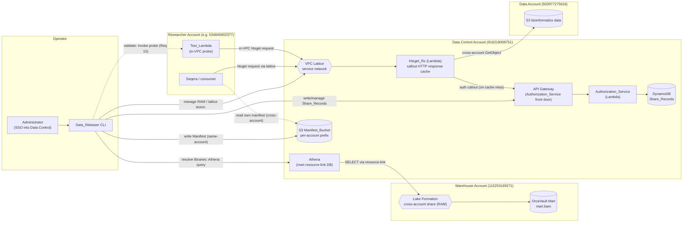

# Design Document

## Overview

The Data Releaser is a Go CLI tool that lets UMCCR administrators grant external
researchers time-bounded (or unlimited) access to specific bioinformatics libraries,
served through htsget-rs over a VPC Lattice private connection. The tool orchestrates
a workflow that spans several AWS accounts: it resolves `library_id`s to concrete S3
prefixes by querying the OrcaVault data warehouse (its curated `mart` layer) via Athena
over a Lake Formation cross-account share, records the grant in an authorization backend
it owns (Data Control account), ensures the researcher can reach htsget-rs (VPC Lattice /
RAM), and publishes a manifest into the researcher's account so they know what they can
query.

The design centers on five decisions established during requirements analysis:

1. **Data Control owns the shares.** The share lifecycle artifacts (Authorization
   Service, DynamoDB, htsget-rs, VPC Lattice, RAM) all live in the Data Control
   account, so that account owns `Share_Record`s (Req 11.4).
2. **Single Data Control identity.** The tool runs under one authenticated session into
   the Data Control account, from any standard AWS credential source (SSO profile,
   `credential_process`, environment, or an assumed role). That identity carries every
   permission the tool needs: querying the warehouse, managing shares, and writing
   manifests into researcher buckets (the latter authorized by each researcher's bucket
   policy). The tool creates no roles — provisioning is out of scope and belongs in IaC
   (Req 11).
3. **Single-query warehouse resolution.** The full `library_id -> portal_run_id -> S3
   path` mapping is resolved by one read-only Athena query against the OrcaVault Mart
   (`mart.bam`, filtered to `format = 'bam'`), consumed through a Lake Formation share
   in the Data Control account. A library with no matching rows is reported as having no
   shareable reads. The grant prefix is derived from the parent prefix of each resolved
   `.bam` key. This replaces the previous two-hop OrcaBus API resolution and removes the
   dependency on the Workflow Manager, Filemanager, and the OrcaBus JWT (Req 1).
4. **Dynamic authorization with one standards-governed cache.** htsget-rs calls the
   Authorization Service at request time and reuses decisions through exactly one cache:
   the standard HTTP response cache that already sits on the callout client, governed by
   the RFC 9111 `Cache-Control` directives the Authorization Service emits (RFC 9111
   obsoleted RFC 7234) together with the cache key the callout client explicitly declares.
   The Authorization Service owns freshness and the `Vary` it declares; the htsget-rs
   deployment owns the cache key (hence per-requester isolation), the TTL ceiling, and the
   storage substrate. Nothing is
   externally flushable, so the Cache_TTL ceiling is itself the revocation SLA
   (Req 4, 13, 14).
5. **This project deploys what it operates, and nothing else.** The Authorization
   Service Lambdas, their DynamoDB table, the API Gateway in front of them, and the
   Manifest_Bucket are deployed from this repository as a CDK application (Req 16).
   Everything else the design depends on — htsget-rs, OrcaVault and its Lake Formation
   share, the VPC Lattice service and RAM share, the Data Account bucket policy, and the
   Researcher_Account RAM/Lattice association — is deployed and owned elsewhere and is
   treated as a stated prerequisite (Req 17).

This document describes the architecture, the components and their interfaces, the
data models, error handling, and the testing strategy. It references the acceptance
criteria in `requirements.md` throughout.

## Architecture

### Account topology and components

Boundaries are AWS accounts; edges are the trust and data flows between components.



### Deployment ownership boundaries

Every component in the diagram above is deployed by exactly one project. This table is
the authoritative split (Req 16.8, Req 17); the documentation set derives its
prerequisite checklist from it (Req 18.5).

| Component | Account | Deployed by |
| --- | --- | --- |
| Authorization_Service Lambdas (callout + admin) | Data Control | **This repo** (`infrastructure/`) |
| DynamoDB `ShareRecords` table and its two GSIs | Data Control | **This repo** |
| API Gateway REST API and stage | Data Control | **This repo** |
| Lambda execution roles for the above | Data Control | **This repo** |
| Manifest_Bucket and its cross-account read bucket policy | Data Control | **This repo** |
| Operator/admin IAM policy (Req 11.2) | Data Control | **This repo** (optional; never by the CLI at runtime) |
| Htsget_Rs Lambda and its `[auth.authorization]` callout config | Data Control | elsewhere |
| VPC Lattice service, service network, and RAM share | Data Control | elsewhere |
| Lake Formation `mart` resource link, grants, Athena workgroup | Data Control | elsewhere |
| Htsget_Rs cross-account read role | Data Control | elsewhere |
| OrcaVault, the `mart` layer, and the Lake Formation share | Warehouse | OrcaHouse |
| Bioinformatics S3 bucket and its bucket policy | Data | elsewhere |
| RAM share acceptance and VPC Lattice association | Researcher | researcher onboarding deployment |
| IAM policy letting researcher principals read their manifest prefix | Researcher | researcher onboarding deployment |
| Test_Lambda (optional in-VPC probe) | Researcher | htsget VPC Lattice consumer construct |

The CLI itself deploys nothing and creates no IAM (Req 11.3). Where a prerequisite from
the "elsewhere" rows is missing, `validate` is the intended way to find out, and it names
the owning account rather than surfacing a bare AWS error (Req 17.7).

### Key flow: share creation

Covers Req 1 (resolution + record creation), Req 2 (optional expiry), Req 5
(lattice preflight), Req 7 (manifest), Req 11 (per-need credentials), and Req 12
(idempotency).

```mermaid
sequenceDiagram
    autonumber
    actor Admin
    participant CLI as Data_Releaser
    participant Athena as Athena (OrcaVault Mart)
    participant Auth as Authorization_Service
    participant RAM as VPC Lattice / RAM
    participant S3 as Manifest_Bucket (Data Control)

    Admin->>CLI: share --libraries L1,L2 --account R [--expiry D]

    Note over CLI,RAM: Preflight (Req 5): verify lattice/RAM association is active
    CLI->>RAM: association active for R?
    alt association missing/inactive
        RAM-->>CLI: not active
        CLI-->>Admin: refuse, report connectivity gap
    end

    Note over CLI,Athena: Resolve library_id → read files (Req 1, single query)
    CLI->>Athena: SELECT from mart.bam (bam)
    Athena-->>CLI: rows (library_id, portal_run_id, bucket, key, storage_class)
    alt any library has no read files (no shareable BAM rows)
        CLI-->>Admin: report library IDs with no shareable reads, abort
    end
    alt any resolved file has archived storage_class
        CLI-->>Admin: report archived files, abort (not streamable by htsget)
    end

    Note over CLI,Auth: Persist share (Req 1.5, Req 2, Req 12 idempotency)
    CLI->>Auth: check existing active shares (idempotency)
    CLI->>Auth: create Share_Record (libs, S3 prefixes, R, [expiry])
    Auth-->>CLI: share identifier

    Note over CLI,S3: Deliver manifest (Req 7); same-account write to Data Control Manifest_Bucket
    CLI->>S3: put Manifest (htsget base URL, paths, expiry)
    CLI-->>Admin: confirm (share id, count, expiry)
```

### Key flow: authorization at request time

Covers Req 4 (callout), Req 13 (caching), Req 14 (callout-client cache), Req 6
(cross-account data), and revocation/expiry behavior (Req 2, 3).

```mermaid
sequenceDiagram
    autonumber
    participant Cons as Researcher (Seqera)
    participant Lattice as VPC Lattice
    participant HTS as Htsget_Rs
    participant CACHE as Authorization_Cache<br/>(HTTP response cache on the callout client)
    participant APIGW as API Gateway
    participant Auth as Authorization_Service
    participant DDB as DynamoDB
    participant S3 as Data Account S3

    Cons->>Lattice: htsget request (reads/variants)
    Lattice->>HTS: forward request (source VPC ARN)

    HTS->>CACHE: stored response under this identity's declared cache key?
    alt fresh stored response (within s-maxage and the request-side ceiling)
        CACHE-->>HTS: allow rules (no callout)
    else absent, stale, or older than the ceiling
        HTS->>APIGW: auth callout (forwarded headers;<br/>request Cache-Control: max-age = the TTL ceiling)
        APIGW->>Auth: invoke
        Auth->>DDB: query active shares for VPC ARN
        DDB-->>Auth: matching (non-expired, non-revoked) shares
        Note over Auth: allow → Cache-Control: s-maxage = min remaining<br/>lifetime, public + Vary over forwarded headers<br/>(revalidation cross-check, not isolation).<br/>deny → short explicit max-age.<br/>no safe lifetime → no-store
        Auth-->>APIGW: htsgetAuth rules (or empty = deny)
        APIGW-->>HTS: response with an explicit directive
        HTS->>CACHE: store under the declared identity key, and only if<br/>public/s-maxage and a sufficient Vary are present<br/>(else fail closed)
    end

    alt authorized (non-empty htsgetAuth)
        HTS->>S3: GetObject via cross-account role (Req 6)
        S3-->>HTS: byte ranges
        HTS-->>Cons: htsget tickets / data
    else empty rules
        HTS-->>Cons: 401/403 unauthorized
    end

    Note over Auth,CACHE: Revocation (Req 3): the Share_Record is marked revoked<br/>immediately and durably; nothing is flushed. Observation is<br/>bounded by the Cache_TTL ceiling, which is the revocation SLA
```

### Design decisions and rationale

- **Owner = Data Control, not Production.** Concentrates the sharing authority in the
  account whose sole purpose is external data control, contains blast radius, and
  decouples "authorized to share" from "is a production principal." (Req 11.4)
- **Single Data Control identity; researcher trust lives in infra.** The tool
  authenticates once into the Data Control account and uses that identity for every
  command. The manifest is written same-account into the Data Control Manifest_Bucket,
  and researchers read their own manifest cross-account (the bucket policy grants each
  account read on its own prefix). This keeps the earlier multi-account credential broker
  — per-purpose resolution, no-chaining, external-researcher roles — unnecessary.
  (Req 11.1, 11.5)
- **IAM/trust provisioning out of scope for the CLI.** The tool creates no roles, bucket
  policies, or key policies at runtime; it assumes the Data Control credentials exist and
  that the Manifest_Bucket and its cross-account read grants are provisioned by the
  Infrastructure_Stack and onboarding (Req 16.5). (Req 11.3, 11.5)
- **Warehouse resolution over OrcaBus APIs.** Library resolution reads the OrcaVault Mart
  (a downstream warehouse) via a single Athena query rather than chaining the Workflow
  Manager and Filemanager APIs. `mart.bam` already denormalizes `library_id`,
  `portal_run_id`, `bucket`/`key`, `format`, and `storage_class` (curated to the current,
  non-deleted location), so one query does what previously took two API hops plus JWT
  auth. The tradeoffs, both accepted: (1) the Mart rebuilds on a daily schedule, so
  resolution can lag live OrcaBus state by up to ~1 day — fine for sharing
  already-produced data; (2) only aligned-read files are covered today (`mart.bam`);
  variants (VCF/BCF) wait for a warehouse mart. In exchange we drop the OrcaBus JWT
  secret, the Production-account dependency, and all FMAnnotator/Filemanager reasoning.
- **Consume the Mart via Lake Formation, don't reach into the warehouse account.** The
  Warehouse account (115253169271) shares the Mart to the Data Control account through
  Lake Formation / RAM; Data Control holds a resource-link database (`mart`) and queries
  it with local Athena. The tool therefore needs no credentials in the warehouse account,
  and Lake Formation can enforce row/column/cell governance on what is shared. This reuses
  the established OrcaHouse source/consumer pattern. (Req 11.2)
- **Grant at prefix, not per-object.** Shared locations are S3 prefixes (the parent
  prefix of the resolved `.bam` key), so htsget index sidecars resolve under the same
  grant. The `.bai` index is present in `mart.bam` as its own row and is co-located
  under the same prefix as the `.bam`, so index sidecars are covered by the same grant.
  This prefix is narrower than a whole-run output prefix, avoiding over-granting.
  Per-object grants would risk excluding indexes and break htsget. (Req 1.4)
- **One cache, with responsibilities split by who owns the knowledge.** There is exactly
  one authorization cache: the standard HTTP response cache on the htsget-rs callout
  client. The Authorization_Service owns freshness and `Vary`, because only it knows share
  lifetimes and its own decision inputs; the htsget-rs deployment, as cache operator, owns
  the cache key, the TTL ceiling, and the storage substrate. Natural expiry is precise
  because `s-maxage` is the minimum remaining share lifetime; revocation propagates as
  entries expire.
  Nothing is externally invalidatable, so the ceiling is the revocation SLA rather than a
  performance knob. (Req 3, 13; see "Caching model" below.)
- **Dynamic callout retained; static authorization deferred.** Per-researcher isolation
  is enforced at the authorization-decision layer (the callout returns only the caller's
  locations), which the current single global static file cannot express.
- **Shares are immutable; manifests are derived and descriptive.** A share's library set
  does not change in place — editing a researcher's access is done by revoke + recreate
  (Req 3.9). The Manifest is a pure projection of active Share_Records: descriptive only,
  never an access-control surface (enforcement is server-side via the callout), so it can
  be regenerated or overwritten freely (Req 7.8) and stays convergent (Property 9)
  without drift. Adding libraries is compositional (a new share; the manifest unions),
  while removing a subset means revoking and recreating — an accepted tradeoff for the
  simpler immutable-share model.

### Caching model

There is exactly one authorization cache — the Authorization_Cache: the standard HTTP
response cache on the htsget-rs authorization callout client, governed entirely by
RFC 9111 (which obsoleted RFC 7234). No API Gateway response cache is used and no cache
is externally invalidatable, so a revoke is never accelerated by a flush: the Share_Record
is marked revoked immediately and durably, and only its *observation* by htsget-rs is
delayed (Req 3.8).

Because one htsget-rs instance serves many requesters, the Authorization_Cache is a
**shared** cache in RFC 9111 terms, not a private one. That is what brings §3.5 into play:
a shared cache may not reuse a response to a request carrying an `Authorization` header
unless the response explicitly opts in, which is why the allow path emits `public` and
`s-maxage` rather than a bare `max-age`.

Responsibilities are split by who owns the relevant knowledge:

- **The Authorization_Service owns freshness and `Vary`.** On allow it emits
  `Cache-Control: s-maxage=<n>, public` where `<n>` is the minimum remaining lifetime
  among the matched active Share_Records (the ceiling value for unlimited shares); on deny
  it emits a short explicit `max-age` (default 60s) so newly created shares appear
  promptly; where no safe lifetime is determinable it emits `no-store`. Every response
  carries an explicit directive, and it emits a `Vary` listing every forwarded request
  header its decision depends on — which serves as a revalidation cross-check and satisfies
  the fail-closed storage precondition, never as the isolation mechanism (Req 13.1–13.4).
- **The htsget-rs deployment owns the cache key, the ceiling, and the storage substrate.**
  It declares the cache key that isolates entries per requester (see below). The ceiling is
  applied as a request-side `Cache-Control: max-age=<ceiling>` on the callout — the
  RFC 9111 mechanism for a client refusing a stored response older than a given age —
  rather than by bespoke clamping of the response directives (Req 13.5, 14.3).

Two consequences follow, and they are the invariants the implementation must preserve:

- **Isolation is key-based, not `Vary`-based.** Per-requester isolation rests on the cache
  key the callout client explicitly declares, incorporating the hashed forwarded identity
  headers, so distinct identities occupy distinct cache entries and isolation is structural
  (Req 14.4). It cannot rest on `Vary`: the callout response cache implements no
  `Vary`-based secondary cache keying — `Vary` is evaluated only during conditional
  revalidation, where a mismatch triggers a refetch that overwrites the same entry, so it
  yields revalidation rather than separate entries. The fail-closed store precondition
  remains, as defence in depth: a response that does not explicitly permit shared reuse, or
  that does not declare a `Vary` covering the forwarded identity headers, is not stored at
  all (Req 13.3, 13.6). No AWS-specific notion such as a source VPC ARN appears in the
  cache mechanism.
- **A cache may narrow what the origin permitted, never widen it.** Heuristic freshness
  (RFC 9111 §4.2.2) is never applied to an authorization decision; a response with no
  explicit directive is treated as non-cacheable (Req 13.7, 13.8, 14.5).

The staleness bound on a revoked or expired share is therefore `min(share remaining
lifetime at store time, Cache_TTL ceiling)`; for unlimited or long-lived shares this
equals the ceiling (default 1h, maximum 24h). The ceiling is chosen as a deliberate
security decision recording the accepted revocation latency (Req 13.11). Correctness never
depends on the cache being present — an absent or unavailable cache degrades to a fresh
callout, never to an allow (Req 13.10).

## Components and Interfaces

### Data_Releaser CLI

The top-level tool, written in Go. Subcommands map directly to requirements:

| Command | Purpose | Requirements |
| --- | --- | --- |
| `share --libraries <ids> --account <id> [--expiry <dur>]` | Resolve, record, and deliver a share | 1, 2, 7, 12 |
| `revoke <share-id>` | Mark a share revoked; propagation bounded by the Cache_TTL ceiling | 3 |
| `extend <share-id> --duration <dur>` | Update expiry of an active share | 9 |
| `list [--account <id>]` | Audit shares | 8 |
| `validate [--account <id>] [--test-setup]` | Preflight / end-to-end infra check | 15 |

### Authentication

The tool uses a single set of Data Control account credentials for all commands, resolved
via the standard AWS credential chain — no custom credential handling. The operator
authenticates however they normally would (an SSO/`credential_process` profile, environment
variables, or an assumed role); the AWS SDK for Go resolves and refreshes it. Selecting the
source is just a config profile name or the default chain:

```ini
# Illustrative only — any profile the AWS SDK understands works.
[profile data-control]
# SSO settings, or credential_process = <your provider>
```

That identity must carry the permissions for everything the tool does (Req 11.2):

- **Warehouse query** — Athena `StartQueryExecution` / `GetQueryExecution` /
  `GetQueryResults`, Glue/Lake Formation catalog read on the `mart` resource-link database,
  and read of the Athena workgroup S3 results location.
- **Share management** — read/write `Share_Record`s (DynamoDB via the Authorization
  Service) and manage VPC Lattice / RAM. No cache-invalidation permission is required,
  because no externally invalidatable cache exists (Req 3.8).
- **Manifest delivery** — same-account `s3:PutObject`/`s3:DeleteObject` on the Data
  Control Manifest_Bucket, and `lambda:InvokeFunction` on the researcher `Test_Lambda` for
  validation. The manifest write needs no external trust (it is same-account); only the
  `Test_Lambda` invoke is cross-account, succeeding because the researcher's Lambda
  resource policy grants the Data Control account (Req 11.5).

If credentials fail to resolve or a call is denied for a missing permission, the command
reports the failure and exits non-zero without partial actions (Req 11.6).

### OrcaVault client (warehouse resolution)

Resolves libraries to shareable S3 prefixes with a single read-only Athena query against
the OrcaVault Mart, consumed through the Lake Formation resource-link database in the
Data Control account. The client uses the Athena API (`StartQueryExecution`, poll
`GetQueryExecution` until `SUCCEEDED`/`FAILED`, then `GetQueryResults`), running in the
configured workgroup so results land in that workgroup's S3 output location. It never
connects to Redshift directly and holds no warehouse-account credentials (Req 11.2).

Resolution query (conceptual; reads only, `format = 'bam'`):

```sql
SELECT b.library_id,
       b.portal_run_id,
       b.bucket,
       b.key,
       b.format,
       b.storage_class
FROM   mart.bam AS b
WHERE  b.library_id IN (<library_ids>)
  AND  lower(b.format) = 'bam';
```

Shareability (Req 1.1) is determined solely from `mart.bam`: a library ID that returns no
`format = 'bam'` rows is reported as having no shareable reads — with a message noting the
ID may not exist, may not be aligned yet, or may have reads that are archived — and the
share is aborted (Req 1.1, 1.6). The client derives each shared location as an S3 prefix —
the parent prefix of the resolved `.bam` `key` (which covers the co-located `.bai`) — so
index sidecars are covered (Req 1.4). Any row whose `storage_class` is an archived tier
(e.g. `DeepArchive`, Glacier tiers) aborts the share as non-streamable (Req 1.7). Library
IDs are bound as parameterized/validated values (not string-concatenated) to avoid SQL
injection.

Because the Mart is a daily-batch warehouse, resolution reflects the most recent build
and may lag live OrcaBus state by up to ~1 day — accepted for sharing already-produced
data.

### Authorization_Service

An AWS Lambda behind API Gateway (REST API) in the Data Control
account, backed by DynamoDB (Req 10). Two logical interfaces:

1. **Admin interface (used by the CLI via the Data Control role):** create, revoke,
   extend, and list `Share_Record`s. Write path validated and owned by Data Control.
2. **Authorization callout interface (used by htsget-rs):** given the source VPC ARN,
   return an `AuthorizationRestrictions` document for all active shares matching that
   ARN, together with the `Cache-Control` and `Vary` headers of Req 13.1–13.4 — the
   service is the freshness authority for the Authorization_Cache.

The callout response conforms to the htsget-rs schema (version 1). Each entry has a
`location` and an optional `rules` array of Access_Rules (see "Access_Rule sub-schema"
below):

```json
{
  "version": 1,
  "htsgetAuth": [
    { "location": { "id": "<s3-prefix>", "backend": { /* s3 */ } } },
    {
      "location": { "id": "<s3-prefix>", "backend": { /* s3 */ } },
      "rules": [ { "referenceName": "chr1", "format": "BAM", "start": 1000, "end": 2000 } ]
    }
  ]
}
```

An empty `htsgetAuth` array means deny (Req 4.4). Each `location` is an S3 prefix
derived from the share's resolved paths. Omitting `rules` grants unrestricted read-only
access to that location; a populated `rules` array restricts access to the union of the
Access_Rules. The current design grants whole-location access (no `rules`); the
structure is in place for future region- or format-restricted shares.

### Htsget_Rs integration

htsget-rs is configured with `[auth.authorization]` `kind = "callout"` pointing at the
Authorization Service, and with S3 locations referencing the Data Account bucket and
the Data Control cross-account role (Req 6).

**The callout client already caches.** No cache has to be added. `HttpClient::as_inner_built()`
in `htsget-config/src/config/advanced/mod.rs` wraps the `reqwest` client in the
`http-cache-reqwest` `Cache` middleware — `HttpCache { mode: CacheMode::Default, manager:
CACacheManager::new(temp_dir().join("htsget_rs_client_cache"), false), options:
HttpCacheOptions::default() }` — whenever the HTTP client's `use_cache` flag is set, and
`use_cache` on `HttpClientConfig` defaults to `true`. `Auth::fetch_from_callout` in
`htsget-http/src/middleware/auth.rs` performs the authorization callout through exactly
that client, so authorization responses are already being cached with RFC 9111 semantics
(`http-cache-semantics`). The Req 14 contribution therefore *re-founds* the existing cache
on standards-native behaviour rather than introducing a second one. `http-cache-reqwest`
and `reqwest-middleware` are direct dependencies of `htsget-config`, and `http-cache`,
`http-cache-semantics`, and `cacache` already arrive with them in the lock file;
**no new dependency is needed** — in particular no TTL-cache crate, because
`http-cache` already ships an in-memory manager.

**It is a shared cache.** One htsget-rs instance serves many requesters, so the cache is a
*shared* cache in RFC 9111 terms, not a private one — and it already is one:
`CacheOptions::default()` sets `shared: true`. That classification is what brings §3.5
(reuse of a response to a request bearing an `Authorization` header) and the `s-maxage`
directive into play — the freshness half of the Req 13 model. It does *not* bring secondary
cache keys into play: the middleware implements no `Vary`-based secondary keying, so
per-requester isolation comes from the explicitly declared cache key instead (below).
Shared-versus-private treatment is therefore settled by the crate's own default rather than
left as an open question for upstream.

The upstream integration points, as of `umccr/htsget-rs` at the time of writing, are:

| Upstream location | Role in the change |
| --- | --- |
| `htsget-config/src/config/advanced/mod.rs` | `HttpClient::as_inner_built()` — where the `http-cache-reqwest` `Cache` middleware is already attached; where the store choice, the shared-cache treatment, and the declared `HttpCacheOptions.cache_key` are settled |
| `htsget-config/src/config/advanced/callout.rs` | `Callout { url, http, forward }` — carries the `HttpClient` (hence `use_cache`) and the `forward` config whose header set both the declared cache key and the origin's `Vary` are derived from |
| `htsget-config/src/config/advanced/auth/authorization.rs` | `AuthorizationSource::Callout \| Static` — unchanged; the callout arm is the one whose cache behaviour is being pinned down |
| `htsget-config/src/config/advanced/auth/response.rs` | `AuthorizationRestrictions` — the deserialised type; no local duplicate and no bespoke cache entry type is introduced |
| `htsget-http/src/middleware/auth.rs` | `Auth::query_authorization_service`, `Auth::fetch_from_callout`, and `Auth::forwarded_headers` — the callout path that emits the request-side ceiling directive and produces the forwarded header set |

Constraints that follow from that shape and govern the implementation:

- **Treat the cache as shared, and let the directives do the work.** The freshness
  directives the Authorization_Service emits (`s-maxage`, `public`, `no-store`) are honoured
  by the middleware itself; `Vary` is honoured there too, but only during conditional
  revalidation, where a mismatch yields a stale outcome that refetches and overwrites the
  entry. `fetch_from_callout` does **not** need to read `Cache-Control` or `Age` before
  consuming the body, and no such change is made. Reading
  response headers by hand would duplicate `http-cache-semantics` and invite divergence.
- **Apply the ceiling as a request directive.** The configured Cache_TTL ceiling is emitted
  as `Cache-Control: max-age=<ceiling>` on the callout request — the RFC 9111 mechanism by
  which a client refuses a stored response older than a given age — rather than by bespoke
  clamping of the response `max-age` (Req 14.3).
- **Fail closed on storage.** A response is not stored unless it explicitly permits shared
  reuse (`public`, `s-maxage`, or `must-revalidate`) and declares a `Vary` covering the
  forwarded identity headers — a defence-in-depth precondition, not the isolation mechanism
  (Req 13.6). Under `CacheMode::Default` a response with no explicit `Cache-Control` is
  treated as non-cacheable, and heuristic freshness
  (RFC 9111 §4.2.2) is never applied to an authorization decision (Req 14.5).
- **Isolation is deployment-neutral by construction.** Keying on "source VPC ARN" is an AWS
  notion that must not leak into htsget-rs, and it does not need to: isolation rests on an
  explicitly declared `HttpCacheOptions.cache_key` derived — hashed — from the header set
  `Auth::forwarded_headers` already produces, which in this deployment is what carries the
  VPC ARN. The key is a `Fn(&http::request::Parts) -> String`, so it sees the whole request
  including headers; hashing the identity component keeps credentials out of key material,
  which matters because under a disk-backed store the key becomes a filename. Declaring it
  is necessary, not merely preferable: the default key is `format!("{}:{}", method,
  parts.uri)` — method and URI only, no headers — while the callout `url` is a single static
  `Uri` with identity travelling in forwarded headers, so by default every requester shares
  one entry. The caveat is that a declared key *replaces* the default rather than composing
  with it, so it must carry the method/URI distinction itself. Per-identity isolation
  (Req 14.4, Property 2) is therefore structural rather than origin-declared, with no AWS
  semantics upstream.
- **Prefer an in-memory store.** The default `CACacheManager` persists authorization
  decisions into a shared temp directory; an in-memory manager is preferred because these
  decisions are cheap to refetch and short-lived, and durability here is only blast radius
  (Req 14.6).
- **`use_cache` remains the sole toggle.** No duplicate enable/disable and no bespoke
  per-callout cache-enable or TTL-cap configuration block is added; policy should instead be
  scopable per callout kind so the authorization callout, url-storage callouts, and JWKS
  retrieval can differ (Req 14.7, 14.8).

This change lands in the UMCCR htsget-rs repo and is separately tested (Req 14.10).

### Manifest writer

Generates the Manifest JSON and writes it to a per-account key
(`manifests/<researcher-account-id>/manifest.json`) in the Data_Control_Account
Manifest_Bucket using the Data Control credentials. Regenerates on
create/revoke/extend/expiry and deletes the object when no active shares remain (Req 7).

The Manifest_Bucket is a single Data Control bucket owned by this project's
Infrastructure_Stack (Req 7.9, Req 16.5), not a per-researcher bucket. Researchers reach
their own manifest by cross-account read: the bucket policy grants each onboarded
Researcher_Account `s3:GetObject` on its own prefix and nothing else, and the researcher's
own IAM must permit its principals to read it (both sides are required for a cross-account
read). Consequences for this design:

- **The write is same-account.** The tool writes to a bucket in its own account, so the
  earlier cross-account-trust failure mode (a missing or wrong researcher bucket policy on
  the write path) is gone. This strengthens Property 4: the one remaining external
  dependency on the manifest path — the researcher's *read* grant — is not on the write
  path at all, so it can never leave a share persisted with a failed manifest write.
- **The bucket name is configuration sourced from a stack output, not a constant.** The
  tool resolves the bucket from `manifest.bucket` and the object key from
  `manifest.keyTemplate` (default `manifests/{accountId}/manifest.json`); `manifest.bucket`
  is the Infrastructure_Stack output (Req 7.2, Req 16.4). A hard-coded name would drift
  from the deployment.
- **The bucket is checked during preflight, before any Share_Record is written**
  (Req 7.10) — now a same-account `HeadBucket`/put check confirming the stack is deployed,
  rather than a cross-account probe.

Because the Manifest is descriptive only and never consulted for authorization (Req 7.8),
holding it in Data Control rather than the researcher account has no security dimension —
where it lives is purely an operational choice, and a same-account write is the simpler,
more reliable one.

## Infrastructure

### Repository layout

The repository holds three deliverables in one place: the Go CLI, the Go Lambda handlers
it talks to, and the CDK app that deploys them.

```
cmd/                    # Cobra CLI subcommands (share, revoke, extend, list, validate)
internal/               # CLI and handler logic (auth, warehouse, lattice, manifest, ...)
functions/              # Lambda main packages (deployable entrypoints)
  authorization/        #   callout interface, called by htsget-rs
  admin/                #   admin interface, called by the CLI
infrastructure/         # CDK app (TypeScript) — Data Control account resources
docs/                   # operator and administrator documentation (Req 18)
htsget-rs/              # git-ignored sub-clone of umccr/htsget-rs for the Req 14 contribution
main.go                 # CLI entrypoint
```

`functions/` exists because `cmd/` is already the Cobra command package rather than a set
of `main` packages, and because the Lambda entrypoints must be independently buildable
artifacts. They contain wiring only — request decoding, client construction, and a call
into `internal/auth` — so the handler logic has exactly one implementation shared with the
CLI's tests (Req 16.5).

### Infrastructure_Stack (CDK)

CDK in TypeScript, under `infrastructure/`. TypeScript rather than CDK Go because the
surrounding UMCCR deployments — including the htsget VPC Lattice provider and consumer
constructs this system depends on — are CDK TypeScript, so constructs and idioms are
shared rather than reimplemented.

Resources deployed (Req 16.1):

| Resource | Configuration | Requirement |
| --- | --- | --- |
| DynamoDB `ShareRecords` | PK `shareId`; GSI1 PK `targetVpcArn`; GSI2 PK `researcherAccountId` SK `createdAt`; **no TTL** | 16.2, 10.2 |
| Authorization callout Lambda | from `functions/authorization`; reads GSI1 | 16.5, 4.2 |
| Admin Lambda | from `functions/admin`; reads/writes table and GSI2 | 16.5, 10.3 |
| API Gateway REST API + stage | deployed stage; identifier and stage name exported as outputs | 16.3, 16.4 |
| Lambda execution roles | scoped to the table and the indexes each function actually queries | 16.7 |
| Manifest_Bucket + bucket policy | single private bucket; per-account key prefix; block public access; policy grants each onboarded researcher `s3:GetObject` on its own prefix; granted accounts are a stack parameter | 16.5, 7.9 |
| Operator IAM policy | optional; the permissions of Req 11.2 | 16.9 |

Two design constraints worth stating explicitly, because getting them wrong is not
recoverable by configuration:

- **REST API, not HTTP API.** The API type is *not* driven by caching: authorization
  response caching sits entirely in the htsget-rs callout client (Req 13, 14), so it places
  no constraint on the API type, and no response cache cluster is provisioned or billed
  here. The REST API is retained for continuity with the already-specified configuration
  and validation surface — the stack outputs the CLI consumes
  (`endpoints.apiGatewayRestApiId`, `endpoints.apiGatewayStageName`; Req 16.4) and the
  `validate` check that the named REST API stage exists (Req 15.10) — which is exactly the
  continuity Req 16.3 requires. Switching to an HTTP API would churn both surfaces for no
  gain.
- **No DynamoDB TTL.** Expired and revoked Share_Records must stay queryable for `list`
  and audit (Req 8.2), so records are never auto-deleted; effective status is derived at
  read time.

The stack exports the REST API id, stage name, and Manifest_Bucket name as outputs
(Req 16.4), which are exactly the values `endpoints.apiGatewayRestApiId`,
`endpoints.apiGatewayStageName`, and `manifest.bucket` in the CLI configuration. Account,
region, resource naming, and the set of researcher accounts granted manifest read are
stack parameters so the same source deploys to more than one environment and onboarding a
researcher is a configuration change (Req 16.5, 16.10).

The stack deliberately provisions nothing outside the Data Control account. In particular
it does not create any researcher-side resource, any Lake Formation or RAM sharing, or
htsget-rs itself (Req 16.8) — see "Deployment ownership boundaries". The Manifest_Bucket
it does create lives in Data Control; researchers only receive cross-account read on it.

## Data Models

### Share_Record (DynamoDB)

Primary key is `shareId` (Req 10.2). Two GSIs support the query patterns that the
partition key alone cannot: authorization lookup by VPC ARN (Req 4.2) and
per-researcher listing / idempotency (Req 8, 12).

```
Table: ShareRecords
  PK: shareId (string, ULID)

  Attributes:
    researcherAccountId : string
    targetVpcArn        : string
    libraryIds          : string set
    s3Prefixes          : string set        # resolved htsget locations
    createdAt           : string (ISO 8601 UTC)
    expiresAt           : string | null      # null = unlimited (Req 2)
    revokedAt           : string | null
    status              : "active" | "revoked" | "expired"   # effective status
                          # note: "expired" is derived from expiresAt at read time,
                          # not auto-deleted, so audits (Req 8) still see it

  GSI1 (authorization lookup):
    PK: targetVpcArn
    projection: s3Prefixes, expiresAt, revokedAt, status

  GSI2 (list / idempotency):
    PK: researcherAccountId
    SK: createdAt
```

DynamoDB TTL is deliberately **not** used to delete expired records, because expired and
revoked shares must remain visible to `list` (Req 8.2). Effective status is computed by
comparing `expiresAt`/`revokedAt` to the current time.

### Access_Rule sub-schema (shared)

A single restriction sub-schema, mirroring the htsget-rs `ReferenceNameRestriction`, is
used by **both** the Authorization_Service callout response (`htsgetAuth[].rules`) and
the Manifest (`files[].rules`), so the researcher-facing view matches exactly what
Htsget_Rs enforces. There is one model, two surfaces.

```json
{
  "referenceName": "chr1",   // optional; absent = all reference names
  "format": "BAM",           // optional; one of BAM|CRAM|VCF|BCF; absent = all formats
  "start": 1000,             // optional; 0-based inclusive; absent = from the beginning
  "end": 2000                // optional; 0-based exclusive; absent = to the end
}
```

Semantics (identical to htsget-rs): an absent field means that dimension is unrestricted
(allow-all); multiple Access_Rules for the same file/location combine as a **union**; an
absent or empty `rules` array means unrestricted access. Today all shares are
whole-location (no rules); the schema future-proofs region- and format-restricted shares
without a redesign.

### Manifest (JSON in researcher S3)

Per Req 7. Grouped by library; each file is a ready-to-use htsget request path plus
optional Access_Rules. `expiresAt` is the effective expiry per library (latest across
the shares granting it, or `null` if any is unlimited — Req 7.7). One manifest object
per researcher account. The Manifest is **tool-generated and descriptive only** — it
reflects access but does not grant it. Enforcement is entirely server-side, from
Share_Records via the authorization callout; the Manifest is never consulted for
authorization. So modifying the Manifest object has no effect on access (it is not a
control surface), and the Data_Releaser may overwrite it on any regeneration (Req 7.8).
A share's library set is immutable — to change a researcher's libraries, revoke and
recreate (Req 3.9); there is no in-place edit.

```json
{
  "htsgetBaseUrl": "https://htsget-lattice.data-control.umccr.org",
  "generatedAt": "2026-07-10T04:00:00Z",
  "libraries": [
    {
      "libraryId": "L2400001",
      "expiresAt": "2026-08-10T04:00:00Z",
      "files": [
        { "request": "reads/<id>" },
        {
          "request": "reads/<id>",
          "rules": [ { "referenceName": "chr1" } ]
        }
      ]
    }
  ]
}
```

The researcher issues `{htsgetBaseUrl}/{request}`, adding their own runtime query
parameters (referenceName/start/end/fields/class) or a POST body. The current version
emits only `reads/` request paths (aligned reads); the `request` field also encodes the
`variants/` endpoint for when a variant mart is added. An absent or empty `rules` means
unrestricted access to that file.

### Configuration

Supplied via a config file and/or flags; contains no secrets (a credential source
identifier and endpoints only). The Data Control credentials are provisioned externally
(Req 11.3); `profile` names a source the AWS SDK understands, or is omitted to use the
default chain.

```yaml
profile: "data-control"                  # single Data Control identity; omit for default chain (Req 11.1)
warehouse:                               # OrcaVault Mart via Athena (Lake Formation share)
  athenaWorkgroup: "primary"             # workgroup in the Data Control (consumer) account
  database:        "mart"                # Lake Formation resource-link database
  catalog:         "AwsDataCatalog"      # Glue catalog (resource-link), not the Redshift connector
  # results location comes from the workgroup config; override only if the workgroup is unmanaged
  # resultsLocation: "s3://<data-control-athena-results>/data-releaser/"
endpoints:
  authorization:   "https://auth.data-control.umccr.org"
  htsgetBaseUrl:   "https://htsget-lattice.data-control.umccr.org"
  apiGatewayRestApiId: "<rest-api-id>"  # from the Infrastructure_Stack output (Req 16.4)
  apiGatewayStageName: "prod"           # from the Infrastructure_Stack output
manifest:                              # Manifest_Bucket in Data Control (Req 7.9); researchers get cross-account read
  bucket:      "<manifest-bucket>"     # from the Infrastructure_Stack output (Req 16.4)
  keyTemplate: "manifests/{accountId}/manifest.json"   # per-account object key
cache:
  ttlCeiling: "1h"      # Cache_TTL ceiling, max 24h; enforced by the htsget-rs deployment as a
                        # request-side `Cache-Control: max-age` (Req 13.5) — recorded here only so
                        # `revoke` can report the propagation bound / revocation SLA (Req 3.8, 13.11)
  denyTtl:    "60s"     # explicit short max-age the Authorization_Service emits on deny (Req 13.2)
validation:
  canary:               # optional (Req 15.6)
    libraryId: "..."
    account:   "534840902377"
```

## Error Handling

Errors are grouped by category, each with a defined behavior that ties back to the
requirements:

- **Input validation** (empty library list, missing account, expiry < 1 day): reject
  before any network call; non-zero exit; no Athena query is issued (Req 1.2, 2.2).
- **Resolution failures** (a library ID returns no `format = 'bam'` rows from `mart.bam`):
  collect and report all affected library IDs to stderr, then abort with no partial
  records (Req 1.6).
- **Archived-file refusal**: if any resolved read file reports an archived
  `storage_class` (e.g. `DeepArchive` or a Glacier tier), htsget-rs cannot stream it
  without a restore; report the affected library IDs and archived locations and abort
  before any write (Req 1.7).
- **Atomicity / partial failure**: everything that can be checked is checked before the
  `Share_Record` is persisted — lattice/RAM association (Req 5), library resolution and
  archived-storage refusal (Req 1.6, 1.7), and Manifest_Bucket existence and writability
  (Req 7.10). Once those pass, the record is written and the manifest follows. A manifest
  write that still fails at that point leaves the share in place; the CLI reports the
  manifest failure and offers retry rather than rolling back the record, since the share
  is authoritative and the manifest is a derived artifact (Req 7.8). Moving the bucket
  check into preflight is what keeps this consistent with Property 4 (Req 1.8).
- **Missing external prerequisite** (Manifest_Bucket absent, RAM share not accepted,
  Lake Formation resource link missing, DynamoDB table or API Gateway stage not deployed):
  report which prerequisite is unmet and which account owns it, rather than the raw AWS
  error, and point at the deployment that provides it (Req 17.7).
- **Connectivity failures** (OrcaVault Mart via Athena / Lake Formation, Authorization
  Service, RAM/VPC Lattice APIs unreachable, or an Athena query completing in a
  non-success state): identify the failed component and abort without partial state
  (Req 1.8, 5.5, 8.5).
- **Credential / permission failures**: if the Data Control credentials cannot be
  resolved (failed SSO / `credential_process`, missing profile) or a call is denied for a
  missing permission, report the failure and exit non-zero without partial actions
  (Req 11.6).
- **Authorization callout failures (runtime, in htsget-rs)**: fail-closed — deny on
  cache miss when the Authorization Service is unreachable or the response is malformed
  (Req 4.5, 4.6). An absent or unavailable Authorization_Cache degrades to a fresh
  callout, never to an allow (Req 13.10).
- **Cross-account data access failures (htsget-rs -> Data Account S3)**: return a generic
  "file unavailable" to the researcher without leaking account/policy detail (Req 6.3).
- **State-conflict errors** (revoke/extend on an already-revoked or expired share,
  unknown share id): report the specific condition and leave state unchanged (Req 3.3,
  3.5, 3.6, 9.2, 9.4).

## Correctness Properties

Invariants the design must uphold regardless of implementation. The Testing Strategy
below validates these. Properties 1–6 are safety (nothing unauthorized happens);
Properties 7–10 are liveness/temporal (the right thing eventually happens). The
security-sensitive ones (Properties 1 and 2) take priority.

### Property 1: Fail-closed

No data is served unless an active, non-expired, non-revoked Share_Record authorizes the
request. Any error, malformed response, or absent cache yields denial, never access.

**Validates: Requirements 4.5, 4.6, 13.10**

### Property 2: Per-researcher isolation

An authorization decision is never shared across Researcher_Accounts. The mechanism is the
explicitly declared cache key incorporating the hashed forwarded identity headers, so
distinct identities occupy distinct cache entries and isolation is structural; the
fail-closed store precondition — a response that does not explicitly permit shared reuse,
or that does not declare a `Vary` covering the forwarded identity headers, is not stored at
all — stands behind it as defence in depth. Isolation does not rest on `Vary`, and no source
VPC ARN participates. One researcher can therefore never receive another's access.

**Validates: Requirements 13.6, 13.9, 14.4**

### Property 3: Caches never widen access

A cache may only make a decision staler, never turn a deny into an allow; a cache may
narrow what the origin permitted and never widen it, and correctness holds with the cache
removed.

**Validates: Requirements 13.8, 13.10**

### Property 4: No partial shares

A share is fully created or not at all; resolution, archived-file, preflight, or
connectivity failures leave no partial Share_Record.

**Validates: Requirements 1.6, 1.7, 1.8**

### Property 5: Data Control ownership

Every Share_Record is written by the Data_Control_Account, which owns all shares.

**Validates: Requirements 11.4**

### Property 6: No internal disclosure

Errors surfaced to researchers never reveal internal account, path, or policy details.

**Validates: Requirements 6.3**

### Property 7: Bounded revocation

After a revoke, access is denied within the Cache_TTL ceiling. There is no flush and
nothing is externally invalidatable, so the ceiling is itself the revocation SLA.

**Validates: Requirements 3.2, 3.8, 13.1, 13.11**

### Property 8: Bounded expiry

An expired share stops authorizing access no later than its expiry plus the cache
staleness bound.

**Validates: Requirements 2.4, 13.1**

### Property 9: Manifest convergence

After any create/revoke/extend/expiry, the researcher's manifest reflects exactly the
remaining active grants, and is deleted when none remain.

**Validates: Requirements 7.3, 7.4**

### Property 10: Idempotent creation

Repeating an identical share command yields the same share, never a duplicate active
grant.

**Validates: Requirements 12.1**

## Testing Strategy

- **Unit tests (Go)**: the OrcaVault resolution logic (SQL generation with parameterized library IDs,
  bam-only `format` filter, prefix derivation from the `.bam` `key`, no-shareable-reads
  detection (a library ID with no `format = 'bam'` rows in `mart.bam`),
  archived-`storage_class` refusal), idempotency set-matching
  (Req 12), manifest generation/schema (Req 7.6), the `Cache-Control`/`Vary` directives the
  callout response carries (Req 13.1–13.4),
  and effective-status derivation for `Share_Record`s.
- **Integration tests**: Authorization Service Lambda against DynamoDB Local (create/
  revoke/extend/list, GSI query by VPC ARN, cache-header emission); the OrcaVault client
  against a mocked Athena API (query submission, polling, result-set parsing, and
  non-success query states); S3 manifest writes against a local S3 emulator.
- **htsget-rs tests (Req 14.10)**: unit and integration coverage for the existing callout
  response cache — that the request-side `max-age` ceiling is emitted and honoured, that a
  response lacking `public`/`s-maxage` or a sufficient `Vary` is not stored (fail closed),
  that a response with no explicit `Cache-Control` is not stored and gets no heuristic
  freshness, key-based isolation across differing forwarded identity headers (distinct
  identities occupy distinct entries, with the identity component hashed), `use_cache` as the
  sole toggle, concurrency safety, and fresh-callout-on-miss.
- **End-to-end / operational (Req 15)**: the `validate` command doubles as the automated
  end-to-end test. Provider-side checks (roles, OrcaVault Mart reachability via Athena
  over the Lake Formation share, auth schema conformance, htsget-rs health, cross-account
  S3) plus, when a researcher account is
  given, lattice/RAM association and a genuine in-VPC request via the `Test_Lambda`. The
  optional `--test-setup` canary mode exercises the full share path (create synthetic
  share -> invoke Test_Lambda -> clean up).
- **Infrastructure tests (Req 16)**: CDK assertion tests on the synthesised template —
  that the table carries both GSIs and no TTL, that the API is a REST API with a deployed
  stage and that no response cache is provisioned on it, that execution roles
  grant no more than the handlers need, and that the REST API id and stage name are
  exported as outputs.
- **Security-sensitive checks**: verify fail-closed authorization, per-researcher cache
  isolation, and that no secrets are logged or written to config.

## Documentation

Documentation is a deliverable, not a byproduct (Req 18). It lives in `docs/` with a
top-level `README.md` as the entry point, and is organised around the three questions an
operator actually arrives with.

| Document | Answers | Requirement |
| --- | --- | --- |
| `README.md` | What is this, what are the accounts, how do the pieces relate | 18.1 |
| `docs/usage.md` | How do I run each command, with flags, examples, and exit codes | 18.2 |
| `docs/configuration.md` | Every config field, defaults, flag precedence, search paths, annotated example | 18.3 |
| `docs/deployment.md` | How to deploy the Infrastructure_Stack, and how its outputs map to config | 18.4 |
| `docs/prerequisites.md` | Per-account checklist of what this project assumes exists, and who owns each item | 18.5, Req 17 |
| `docs/onboarding.md` | How to onboard a Researcher_Account, ending in a `validate` run | 18.6 |
| `docs/operations.md` | TTL-bounded revocation propagation, immutable library sets, idempotency, ~1 day warehouse lag | 18.7 |
| `docs/manifest.md` | Manifest schema, location, and that it is descriptive only | 18.8 |

Two documentation obligations are structural rather than editorial. The prerequisites
checklist is derived from the "Deployment ownership boundaries" table, so the two must not
drift. And the operational caveats in `docs/operations.md` are the ones an administrator
cannot infer from the CLI's own output — particularly that a revoke is applied to the
Share_Record immediately but observed by htsget-rs only once the cached decision expires,
that propagation is therefore bounded by the Cache_TTL ceiling and the ceiling is itself
the revocation SLA, and that no operator override or manual cache flush exists (Req 18.7).
Documentation is updated in the same change as the behaviour it describes
(Req 18.10).

## Future Directions

Forward-looking notes on the authorization model. These are deliberately **out of scope**
for the current implementation (which grants whole-library access only), recorded so the
design can evolve without surprises.

- **The callout is a PDP/PEP split, and that stays.** Htsget_Rs is the Policy Enforcement
  Point; the Authorization_Service is the Policy Decision Point. This externalized,
  dynamic authorization model is sound and should be retained regardless of how the policy
  language evolves.
- **No GA4GH standard exists for the fine-grained access-restriction shape.** The
  [htsget specification](https://samtools.github.io/hts-specs/htsget.html) leaves
  authorization to implementers, so `AuthorizationRestrictions` / `htsgetAuth` is a
  UMCCR/htsget-rs-specific schema. There is no interoperability standard to conform to for
  per-region/format rules — UMCCR owns this schema and its evolution.
- **Current limitation: allow-only.** The rule model can only express permitted scopes; it
  cannot express exclusions ("everything except this region/gene"), a common
  genomic-privacy need. The highest-ROI improvement — and the one cheapest to make while
  htsget-rs auth is still a pre-release feature branch — is adding a `permit` / `forbid`
  effect to the rule (deny overriding allow). Retrofitting deny after release is costly
  because it changes evaluation semantics.
- **Identity and consent belong in separate layers, not the region rules.** The "who"
  dimension aligns with GA4GH Passports/Visas (the callout could key off passport claims
  rather than only the source VPC ARN); data-use/consent aligns with GA4GH DUO codes.
  Neither should be folded into an Access_Rule — they are orthogonal concerns handled by
  their own standards.
- **Escalation path: a real policy language.** If authorization grows to need boolean
  logic, conditions, or attributes, adopt a purpose-built, analyzable policy engine (for
  example Cedar, which has a native Rust implementation and permit/forbid semantics)
  rather than extending the tuple model indefinitely. Likely overkill today.
- **Discovery vs enforcement will diverge.** The Manifest (discovery: "what can I see")
  and the callout response (enforcement: "is this request allowed") currently share the
  Access_Rule sub-schema. That sharing is valid ONLY while the policy is a pure allow-list.
  If `forbid` or conditions are added, the Manifest MUST present the evaluated *effective*
  access rather than the raw policy — a researcher should never have to resolve
  permit/forbid logic themselves. Treat the shared schema as a current convenience, not a
  permanent coupling.

## Appendix A: Cedar-based authorization (exploratory, not current scope)

A sketch of the escalation path above, should authorization ever need exclusions,
consent, or attribute conditions. Not part of the current build.

**Shape.** The Authorization_Service compiles each `Share_Record` into Cedar policies plus
an entity store (researchers, libraries, files) instead of an `AuthorizationRestrictions`
document. htsget-rs embeds the `cedar-policy` crate and evaluates each request locally with
`is_authorized`. The callout then caches the policy set + entities per requester (policies
change only on admin actions), and revocation still propagates as those cached entries
expire, bounded by the same Cache_TTL ceiling.

**Three inputs to a decision.** Cedar's `is_authorized` combines: (1) **policies** — the
`permit`/`forbid` rules; (2) **entities** — the facts the rules read (each principal /
resource with attributes and `parents` hierarchy), published by the Authorization_Service
alongside the policies and cached by htsget-rs; (3) the **request** — built by htsget-rs
per call. Policies + entities are how the Authorization_Service signals what is allowed;
the request is htsget-rs's own per-call question. Entity attributes must be sourced at
share creation (e.g. `format` from the OrcaVault Mart, resource `duoCodes` from dataset consent
metadata, principal `approvedPurposes` from the researcher's passport) — extra data a
plain allow-list does not need.

Example entities (published by the Authorization_Service, cached by htsget-rs) and a
request (built by htsget-rs from the incoming htsget query):

```jsonc
// entities
[
  {
    "uid": {
      "type": "Researcher",
      "id":"534840902377"
    },
    "attrs": {
      "approvedPurposes": []
    }, 
    "parents": []
  },
  {
    "uid": {
      "type": "File",
      "id": "variants/<id>"
    },
    "attrs": {
      "format": "VCF"
    }, 
    "parents": [
      {
        "type": "Library",
        "id": "L2400001"
      }
    ]
  }
]

// request
principal = Researcher::"534840902377"
action    = Action::"variants"
resource  = File::"variants/<id>"
context   = { "now": 1752000000, "referenceName": "chr1", "start": 1500, "end": 1800, "format": "VCF" }
```

**Mapping.** principal = researcher (VPC ARN or future Passport identity); action =
`reads` / `variants`; resource = file in library (with `format` etc.); context =
request-time `referenceName` / `start` / `end` / `format` / `now`.

**Representative policies** (expiry becomes a condition; `forbid` gives the exclusions the
tuple model cannot express, and always overrides `permit`; the last example shows consent
expressed with DUO codes matched on both the principal's approved purposes and the
resource):

```cedar
permit (
  principal == Researcher::"534840902377",
  action in [Action::"reads", Action::"variants"],
  resource in Library::"L2400001"
) when { context.now <= 1786579200 };        // expiry epoch, supplied by htsget-rs

forbid (principal, action, resource)
when { context.referenceName == "chrY" };    // consent-restricted contig

permit (
  principal == Researcher::"534840902377",
  action == Action::"variants",
  resource in Library::"L2400001"
) when {
  context.referenceName == "chr1" &&
  context.start >= 1000 && context.end <= 2000 &&
  resource.format == "VCF"                    // region + format restriction
};

permit (principal, action, resource in Project::"cohort-x")
when {
  principal.approvedPurposes.contains("DUO:0000007") &&   // disease-specific
  resource.duoCodes.contains("DUO:0000007")
};
```

**Key mismatch.** Cedar is a boolean decision engine; it does not clip intervals the way
htsget-rs's `constraint_interval` logic does. Either (a) go pure-boolean (deny requests
that exceed the allowed range), or (b) hybrid — Cedar for all categorical logic
(principal/action/resource/format/referenceName/deny/consent) and a thin interval layer in
htsget-rs for numeric clipping. This choice determines whether any existing interval code
is retained.

**When it's worth it.** Overkill for whole-library and simple region/format grants. It
earns its keep once any two of {exclusions, consent/DUO conditions, identity-attribute
conditions} are needed, at which point it delivers them in one validated model.
