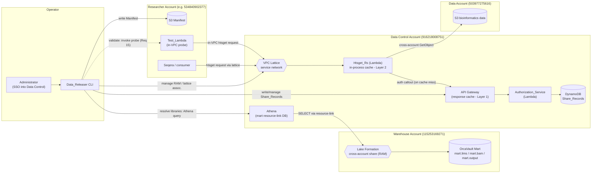
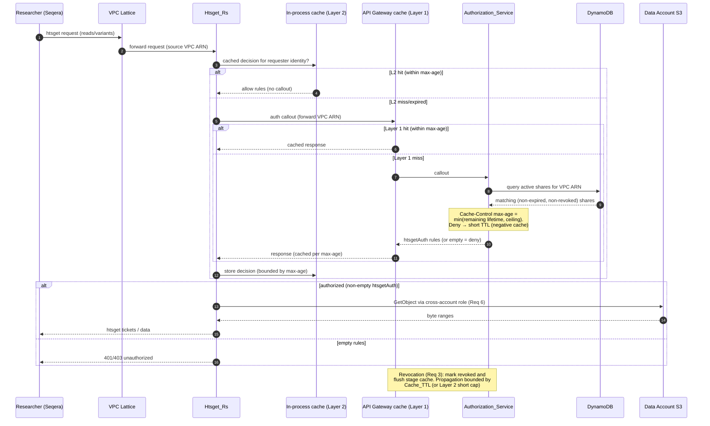

# Design Document

## Overview

The Data Releaser is a Go CLI tool that lets UMCCR administrators grant external
researchers time-bounded (or unlimited) access to specific bioinformatics libraries,
served through htsget-rs over a VPC Lattice private connection. The tool orchestrates
a workflow that spans several AWS accounts: it resolves `library_id`s to concrete S3
prefixes by querying the OrcaVault data warehouse (its curated `mart` layer) via Athena
over a Lake Formation cross-account share, records the grant in an authorization backend
it owns (Data Control account), ensures the researcher can reach htsget-rs (VPC Lattice /
RAM), and publishes a manifest into the researcher's account so they know what they can
query.

The design centers on four decisions established during requirements analysis:

1. **Data Control owns the shares.** The share lifecycle artifacts (Authorization
   Service, DynamoDB, htsget-rs, VPC Lattice, RAM) all live in the Data Control
   account, so that account owns `Share_Record`s (Req 11.4).
2. **Single Data Control identity.** The tool runs under one authenticated session into
   the Data Control account, from any standard AWS credential source (SSO profile,
   `credential_process`, environment, or an assumed role). That identity carries every
   permission the tool needs: querying the warehouse, managing shares, and writing
   manifests into researcher buckets (the latter authorized by each researcher's bucket
   policy). The tool creates no roles — provisioning is out of scope and belongs in IaC
   (Req 11).
3. **Single-query warehouse resolution.** The full `library_id -> portal_run_id -> S3
   path` mapping is resolved by one read-only Athena query against the OrcaVault Mart
   (`mart.lims` to validate existence, `mart.bam` for read files, `mart.output` for the
   grant prefix), consumed through a Lake Formation share in the Data Control account.
   This replaces the previous two-hop OrcaBus API resolution and removes the dependency
   on the Workflow Manager, Filemanager, and the OrcaBus JWT (Req 1).
4. **Dynamic authorization with bounded caching.** htsget-rs calls the Authorization
   Service at request time, but reuses decisions through two cache layers to avoid a
   callout per request. Expiry is made precise via `max-age`; revocation is bounded by
   cache TTL and can be accelerated by a cache flush (Req 4, 13, 14).

This document describes the architecture, the components and their interfaces, the
data models, error handling, and the testing strategy. It references the acceptance
criteria in `requirements.md` throughout.

## Architecture

### Account topology and components

Boundaries are AWS accounts; edges are the trust and data flows between components.



### Key flow: share creation

Covers Req 1 (resolution + record creation), Req 2 (optional expiry), Req 5
(lattice preflight), Req 7 (manifest), Req 11 (per-need credentials), and Req 12
(idempotency).

```mermaid
sequenceDiagram
    autonumber
    actor Admin
    participant CLI as Data_Releaser
    participant Athena as Athena (OrcaVault Mart)
    participant Auth as Authorization_Service
    participant RAM as VPC Lattice / RAM
    participant S3 as Researcher S3 (Manifest)

    Admin->>CLI: share --libraries L1,L2 --account R [--expiry D]

    Note over CLI,RAM: Preflight (Req 5): verify lattice/RAM association is active
    CLI->>RAM: association active for R?
    alt association missing/inactive
        RAM-->>CLI: not active
        CLI-->>Admin: refuse, report connectivity gap
    end

    Note over CLI,Athena: Resolve library_id → read files (Req 1, single query)
    CLI->>Athena: SELECT from mart.lims / mart.bam (bam,cram) + join mart.output
    Athena-->>CLI: rows (library_id, portal_run_id, bucket, key, storage_class, output prefix)
    alt any library unknown (no mart.lims row) or has no read files
        CLI-->>Admin: report unknown/unmapped library IDs, abort
    end
    alt any resolved file has archived storage_class
        CLI-->>Admin: report archived files, abort (not streamable by htsget)
    end

    Note over CLI,Auth: Persist share (Req 1.5, Req 2, Req 12 idempotency)
    CLI->>Auth: check existing active shares (idempotency)
    CLI->>Auth: create Share_Record (libs, S3 prefixes, R, [expiry])
    Auth-->>CLI: share identifier

    Note over CLI,S3: Deliver manifest (Req 7); researcher bucket policy grants Data Control
    CLI->>S3: put Manifest (htsget base URL, paths, expiry)
    CLI-->>Admin: confirm (share id, count, expiry)
```

### Key flow: authorization at request time

Covers Req 4 (callout), Req 13 (caching), Req 14 (in-process cache), Req 6
(cross-account data), and revocation/expiry behavior (Req 2, 3).



### Design decisions and rationale

- **Owner = Data Control, not Production.** Concentrates the sharing authority in the
  account whose sole purpose is external data control, contains blast radius, and
  decouples "authorized to share" from "is a production principal." (Req 11.4)
- **Single Data Control identity; researcher trust lives in infra.** The tool
  authenticates once into the Data Control account and uses that identity for every
  command. Manifest delivery works cross-account because each researcher bucket policy
  grants the Data Control account write/delete on the manifest key (plus a KMS key-policy
  grant if the bucket is SSE-KMS encrypted). That trust is provisioned externally, not by
  the tool, which keeps the earlier multi-account credential broker — per-purpose
  resolution, no-chaining, external-researcher roles — unnecessary. (Req 11.1, 11.5)
- **IAM/trust provisioning out of scope.** The tool creates no roles, bucket policies, or
  key policies; it assumes the Data Control credentials and the researcher-side grants
  already exist (defined via IaC). (Req 11.3, 11.5)
- **Warehouse resolution over OrcaBus APIs.** Library resolution reads the OrcaVault Mart
  (a downstream warehouse) via a single Athena query rather than chaining the Workflow
  Manager and Filemanager APIs. The Mart already denormalizes `library_id`,
  `portal_run_id`, `bucket`/`key`, `format`, and `storage_class` (curated to the current,
  non-deleted location), so one query does what previously took two API hops plus JWT
  auth. The tradeoffs, both accepted: (1) the Mart rebuilds on a daily schedule, so
  resolution can lag live OrcaBus state by up to ~1 day — fine for sharing
  already-produced data; (2) only aligned-read files are covered today (`mart.bam`);
  variants (VCF/BCF) wait for a warehouse mart. In exchange we drop the OrcaBus JWT
  secret, the Production-account dependency, and all FMAnnotator/Filemanager reasoning.
- **Consume the Mart via Lake Formation, don't reach into the warehouse account.** The
  Warehouse account (115253169271) shares the Mart to the Data Control account through
  Lake Formation / RAM; Data Control holds a resource-link database (`mart`) and queries
  it with local Athena. The tool therefore needs no credentials in the warehouse account,
  and Lake Formation can enforce row/column/cell governance on what is shared. This reuses
  the established OrcaHouse source/consumer pattern. (Req 11.2)
- **Grant at prefix, not per-object.** Shared locations are S3 prefixes (the workflow
  output prefix from `mart.output`, else the file's parent prefix), so htsget index
  sidecars (`.bai`/`.crai`/`.csi`) resolve under the same grant. Per-object grants would
  risk excluding indexes and break htsget. (Req 1.4)
- **Two cache layers with different TTL policies.** The API Gateway cache (Layer 1) is
  externally flushable; the htsget-rs in-process cache (Layer 2) is not. `max-age` is
  set to the exact remaining share lifetime so natural expiry is precise; revocation is
  handled by flushing Layer 1, with Layer 2 given a short cap so warm containers pick up
  the change quickly. (Req 3, 13; see "Caching model" below.)
- **Dynamic callout retained; static authorization deferred.** Per-researcher isolation
  is enforced at the authorization-decision layer (the callout returns only the caller's
  locations), which the current single global static file cannot express.
- **Shares are immutable; manifests are derived and descriptive.** A share's library set
  does not change in place — editing a researcher's access is done by revoke + recreate
  (Req 3.9). The Manifest is a pure projection of active Share_Records: descriptive only,
  never an access-control surface (enforcement is server-side via the callout), so it can
  be regenerated or overwritten freely (Req 7.8) and stays convergent (Property 9)
  without drift. Adding libraries is compositional (a new share; the manifest unions),
  while removing a subset means revoking and recreating — an accepted tradeoff for the
  simpler immutable-share model.

### Caching model

The staleness bound on a revoked share is `min(share remaining lifetime at cache time,
Cache_TTL ceiling)`; for unlimited or long-lived shares this equals the ceiling
(default 1h, configurable up to 24h). Two independent policies apply:

- **Layer 1 (API Gateway)**: TTL aligned to `max-age` (up to the ceiling). Flushable via
  `flushStageCache` on revoke for near-immediate propagation.
- **Layer 2 (htsget-rs in-process)**: short hard cap independent of `max-age`, because it
  cannot be externally invalidated; also bounded by warm-container lifetime.

To keep the total bound at the ceiling rather than compounding, Layer 1 must emit the
HTTP `Age` header and Layer 2 must honor it when computing remaining freshness
(implementation constraint for Req 14). Correctness never depends on any cache being
present — every layer falls back to a fresh callout (Req 13.10).

## Components and Interfaces

### Data_Releaser CLI

The top-level tool, written in Go. Subcommands map directly to requirements:

| Command | Purpose | Requirements |
| --- | --- | --- |
| `share --libraries <ids> --account <id> [--expiry <dur>]` | Resolve, record, and deliver a share | 1, 2, 7, 12 |
| `revoke <share-id> [--flush-cache]` | Mark a share revoked; optionally flush Layer 1 | 3 |
| `extend <share-id> --duration <dur>` | Update expiry of an active share | 9 |
| `list [--account <id>]` | Audit shares | 8 |
| `validate [--account <id>] [--test-setup]` | Preflight / end-to-end infra check | 15 |

### Authentication

The tool uses a single set of Data Control account credentials for all commands, resolved
via the standard AWS credential chain — no custom credential handling. The operator
authenticates however they normally would (an SSO/`credential_process` profile, environment
variables, or an assumed role); the AWS SDK for Go resolves and refreshes it. Selecting the
source is just a config profile name or the default chain:

```ini
# Illustrative only — any profile the AWS SDK understands works.
[profile data-control]
# SSO settings, or credential_process = <your provider>
```

That identity must carry the permissions for everything the tool does (Req 11.2):

- **Warehouse query** — Athena `StartQueryExecution` / `GetQueryExecution` /
  `GetQueryResults`, Glue/Lake Formation catalog read on the `mart` resource-link database,
  and read of the Athena workgroup S3 results location.
- **Share management** — read/write `Share_Record`s (DynamoDB via the Authorization
  Service), manage VPC Lattice / RAM, and flush the API Gateway cache.
- **Manifest delivery** — cross-account `s3:PutObject`/`s3:DeleteObject` on the researcher
  manifest bucket, and `lambda:InvokeFunction` on the researcher `Test_Lambda` for
  validation. These succeed because the researcher-side resource policies (bucket policy,
  KMS key policy, Lambda resource policy) grant the Data Control account; that trust is
  provisioned externally, not by the tool (Req 11.5).

If credentials fail to resolve or a call is denied for a missing permission, the command
reports the failure and exits non-zero without partial actions (Req 11.6).

### OrcaVault client (warehouse resolution)

Resolves libraries to shareable S3 prefixes with a single read-only Athena query against
the OrcaVault Mart, consumed through the Lake Formation resource-link database in the
Data Control account. The client uses the Athena API (`StartQueryExecution`, poll
`GetQueryExecution` until `SUCCEEDED`/`FAILED`, then `GetQueryResults`), running in the
configured workgroup so results land in that workgroup's S3 output location. It never
connects to Redshift directly and holds no warehouse-account credentials (Req 11.2).

Resolution query (conceptual; reads only, `format` in (`bam`,`cram`)):

```sql
SELECT b.library_id,
       b.portal_run_id,
       b.bucket,
       b.key,
       b.format,
       b.storage_class,
       o.bucket  AS output_bucket,
       o.prefix  AS output_prefix
FROM   mart.bam AS b
LEFT   JOIN mart.output AS o ON o.portal_run_id = b.portal_run_id
WHERE  b.library_id IN (<library_ids>)
  AND  lower(b.format) IN ('bam', 'cram');
```

Library existence (Req 1.1) is confirmed with a companion probe against `mart.lims`
(`SELECT DISTINCT library_id FROM mart.lims WHERE library_id IN (...)`); a library absent
from `mart.lims` is reported as unknown, and a library present but returning no `mart.bam`
rows is reported as having no shareable reads (Req 1.6). The client derives each shared
location as an S3 prefix — the `output_prefix` when present, otherwise the parent prefix
of `key` — so index sidecars are covered (Req 1.4). Any row whose `storage_class` is an
archived tier (e.g. `DeepArchive`, Glacier tiers) aborts the share as non-streamable
(Req 1.7). Library IDs are bound as parameterized/validated values (not string-concatenated)
to avoid SQL injection.

Because the Mart is a daily-batch warehouse, resolution reflects the most recent build
and may lag live OrcaBus state by up to ~1 day — accepted for sharing already-produced
data.

### Authorization_Service

An AWS Lambda behind API Gateway (REST API, caching enabled) in the Data Control
account, backed by DynamoDB (Req 10). Two logical interfaces:

1. **Admin interface (used by the CLI via the Data Control role):** create, revoke,
   extend, and list `Share_Record`s. Write path validated and owned by Data Control.
2. **Authorization callout interface (used by htsget-rs):** given the source VPC ARN,
   return an `AuthorizationRestrictions` document for all active shares matching that
   ARN, with a `Cache-Control` header per Req 13.1/13.2.

The callout response conforms to the htsget-rs schema (version 1). Each entry has a
`location` and an optional `rules` array of Access_Rules (see "Access_Rule sub-schema"
below):

```json
{
  "version": 1,
  "htsgetAuth": [
    { "location": { "id": "<s3-prefix>", "backend": { /* s3 */ } } },
    {
      "location": { "id": "<s3-prefix>", "backend": { /* s3 */ } },
      "rules": [ { "referenceName": "chr1", "format": "BAM", "start": 1000, "end": 2000 } ]
    }
  ]
}
```

An empty `htsgetAuth` array means deny (Req 4.4). Each `location` is an S3 prefix
derived from the share's resolved paths. Omitting `rules` grants unrestricted read-only
access to that location; a populated `rules` array restricts access to the union of the
Access_Rules. The current design grants whole-location access (no `rules`); the
structure is in place for future region- or format-restricted shares.

### Htsget_Rs integration

htsget-rs is configured with `[auth.authorization]` `kind = "callout"` pointing at the
Authorization Service, and with S3 locations referencing the Data Account bucket and
the Data Control cross-account role (Req 6). The callout client is enhanced (Req 14) to
cache responses in-process keyed on requester identity, honoring `Cache-Control:
max-age` (and `Age`), with a configurable enable/disable and TTL cap. This change lands
in the UMCCR htsget-rs repo and is separately tested.

### Manifest writer

Generates the Manifest JSON and writes it to a well-known key in the researcher's S3
bucket using the Data Control credentials, which the researcher bucket policy grants
(Req 11.5). Regenerates on create/revoke/extend/expiry and deletes the object when no
active shares remain (Req 7).

## Data Models

### Share_Record (DynamoDB)

Primary key is `shareId` (Req 10.2). Two GSIs support the query patterns that the
partition key alone cannot: authorization lookup by VPC ARN (Req 4.2) and
per-researcher listing / idempotency (Req 8, 12).

```
Table: ShareRecords
  PK: shareId (string, ULID)

  Attributes:
    researcherAccountId : string
    targetVpcArn        : string
    libraryIds          : string set
    s3Prefixes          : string set        # resolved htsget locations
    createdAt           : string (ISO 8601 UTC)
    expiresAt           : string | null      # null = unlimited (Req 2)
    revokedAt           : string | null
    status              : "active" | "revoked" | "expired"   # effective status
                          # note: "expired" is derived from expiresAt at read time,
                          # not auto-deleted, so audits (Req 8) still see it

  GSI1 (authorization lookup):
    PK: targetVpcArn
    projection: s3Prefixes, expiresAt, revokedAt, status

  GSI2 (list / idempotency):
    PK: researcherAccountId
    SK: createdAt
```

DynamoDB TTL is deliberately **not** used to delete expired records, because expired and
revoked shares must remain visible to `list` (Req 8.2). Effective status is computed by
comparing `expiresAt`/`revokedAt` to the current time.

### Access_Rule sub-schema (shared)

A single restriction sub-schema, mirroring the htsget-rs `ReferenceNameRestriction`, is
used by **both** the Authorization_Service callout response (`htsgetAuth[].rules`) and
the Manifest (`files[].rules`), so the researcher-facing view matches exactly what
Htsget_Rs enforces. There is one model, two surfaces.

```json
{
  "referenceName": "chr1",   // optional; absent = all reference names
  "format": "BAM",           // optional; one of BAM|CRAM|VCF|BCF; absent = all formats
  "start": 1000,             // optional; 0-based inclusive; absent = from the beginning
  "end": 2000                // optional; 0-based exclusive; absent = to the end
}
```

Semantics (identical to htsget-rs): an absent field means that dimension is unrestricted
(allow-all); multiple Access_Rules for the same file/location combine as a **union**; an
absent or empty `rules` array means unrestricted access. Today all shares are
whole-location (no rules); the schema future-proofs region- and format-restricted shares
without a redesign.

### Manifest (JSON in researcher S3)

Per Req 7. Grouped by library; each file is a ready-to-use htsget request path plus
optional Access_Rules. `expiresAt` is the effective expiry per library (latest across
the shares granting it, or `null` if any is unlimited — Req 7.7). One manifest object
per researcher account. The Manifest is **tool-generated and descriptive only** — it
reflects access but does not grant it. Enforcement is entirely server-side, from
Share_Records via the authorization callout; the Manifest is never consulted for
authorization. So modifying the Manifest object has no effect on access (it is not a
control surface), and the Data_Releaser may overwrite it on any regeneration (Req 7.8).
A share's library set is immutable — to change a researcher's libraries, revoke and
recreate (Req 3.9); there is no in-place edit.

```json
{
  "htsgetBaseUrl": "https://htsget-lattice.data-control.umccr.org",
  "generatedAt": "2026-07-10T04:00:00Z",
  "libraries": [
    {
      "libraryId": "L2400001",
      "expiresAt": "2026-08-10T04:00:00Z",
      "files": [
        { "request": "reads/<id>" },
        {
          "request": "reads/<id>",
          "rules": [ { "referenceName": "chr1" } ]
        }
      ]
    }
  ]
}
```

The researcher issues `{htsgetBaseUrl}/{request}`, adding their own runtime query
parameters (referenceName/start/end/fields/class) or a POST body. The current version
emits only `reads/` request paths (aligned reads); the `request` field also encodes the
`variants/` endpoint for when a variant mart is added. An absent or empty `rules` means
unrestricted access to that file.

### Configuration

Supplied via a config file and/or flags; contains no secrets (a credential source
identifier and endpoints only). The Data Control credentials are provisioned externally
(Req 11.3); `profile` names a source the AWS SDK understands, or is omitted to use the
default chain.

```yaml
profile: "data-control"                  # single Data Control identity; omit for default chain (Req 11.1)
warehouse:                               # OrcaVault Mart via Athena (Lake Formation share)
  athenaWorkgroup: "primary"             # workgroup in the Data Control (consumer) account
  database:        "mart"                # Lake Formation resource-link database
  catalog:         "AwsDataCatalog"      # Glue catalog (resource-link), not the Redshift connector
  # results location comes from the workgroup config; override only if the workgroup is unmanaged
  # resultsLocation: "s3://<data-control-athena-results>/data-releaser/"
endpoints:
  authorization:   "https://auth.data-control.umccr.org"
  htsgetBaseUrl:   "https://htsget-lattice.data-control.umccr.org"
cache:
  ttlCeiling: "1h"      # max-age ceiling (Req 13.1)
  denyTtl:    "60s"     # negative cache (Req 13.2)
validation:
  canary:               # optional (Req 15.6)
    libraryId: "..."
    account:   "534840902377"
```

## Error Handling

Errors are grouped by category, each with a defined behavior that ties back to the
requirements:

- **Input validation** (empty library list, missing account, expiry < 1 day): reject
  before any network call; non-zero exit; no Athena query is issued (Req 1.2, 2.2).
- **Resolution failures** (library unknown to `mart.lims`, or no `mart.bam` read files):
  collect and report all unknown/unmapped IDs to stderr, then abort with no partial
  records (Req 1.6).
- **Archived-file refusal**: if any resolved read file reports an archived
  `storage_class` (e.g. `DeepArchive` or a Glacier tier), htsget-rs cannot stream it
  without a restore; report the affected library IDs and archived locations and abort
  before any write (Req 1.7).
- **Atomicity / partial failure**: a share is only considered created once the
  `Share_Record` is persisted. Manifest write happens after; if it fails, the share
  exists but the CLI reports the manifest failure and offers retry rather than rolling
  back the record. Resolution/preflight failures abort before any write (Req 1.8).
- **Connectivity failures** (OrcaVault Mart via Athena / Lake Formation, Authorization
  Service, RAM/VPC Lattice APIs unreachable, or an Athena query completing in a
  non-success state): identify the failed component and abort without partial state
  (Req 1.8, 5.5, 8.5).
- **Credential / permission failures**: if the Data Control credentials cannot be
  resolved (failed SSO / `credential_process`, missing profile) or a call is denied for a
  missing permission, report the failure and exit non-zero without partial actions
  (Req 11.6).
- **Authorization callout failures (runtime, in htsget-rs)**: fail-closed — deny on
  cache miss when the Authorization Service is unreachable or the response is malformed
  (Req 4.5, 4.6). Cache-layer unavailability degrades to a fresh callout, never to an
  allow (Req 13.10).
- **Cross-account data access failures (htsget-rs -> Data Account S3)**: return a generic
  "file unavailable" to the researcher without leaking account/policy detail (Req 6.3).
- **State-conflict errors** (revoke/extend on an already-revoked or expired share,
  unknown share id): report the specific condition and leave state unchanged (Req 3.3,
  3.5, 3.6, 9.2, 9.4).

## Correctness Properties

Invariants the design must uphold regardless of implementation. The Testing Strategy
below validates these. Properties 1–6 are safety (nothing unauthorized happens);
Properties 7–10 are liveness/temporal (the right thing eventually happens). The
security-sensitive ones (Properties 1 and 2) take priority.

### Property 1: Fail-closed

No data is served unless an active, non-expired, non-revoked Share_Record authorizes the
request. Any error, malformed response, or absent cache yields denial, never access.

**Validates: Requirements 4.5, 4.6, 13.10**

### Property 2: Per-researcher isolation

An authorization decision is never shared across Researcher_Accounts; every cache layer
keys on the requester identity, so one researcher can never receive another's access.

**Validates: Requirements 13.3, 13.9**

### Property 3: Caches never widen access

A cache may only make a decision staler, never turn a deny into an allow; correctness
holds with all caches removed.

**Validates: Requirements 13.10**

### Property 4: No partial shares

A share is fully created or not at all; resolution, archived-file, preflight, or
connectivity failures leave no partial Share_Record.

**Validates: Requirements 1.6, 1.7, 1.8**

### Property 5: Data Control ownership

Every Share_Record is written by the Data_Control_Account, which owns all shares.

**Validates: Requirements 11.4**

### Property 6: No internal disclosure

Errors surfaced to researchers never reveal internal account, path, or policy details.

**Validates: Requirements 6.3**

### Property 7: Bounded revocation

After a revoke, access is denied within the Cache_TTL ceiling, or immediately if the
Authorization_Cache is flushed.

**Validates: Requirements 3.2, 3.8, 13.1**

### Property 8: Bounded expiry

An expired share stops authorizing access no later than its expiry plus the cache
staleness bound.

**Validates: Requirements 2.4, 13.1**

### Property 9: Manifest convergence

After any create/revoke/extend/expiry, the researcher's manifest reflects exactly the
remaining active grants, and is deleted when none remain.

**Validates: Requirements 7.3, 7.4**

### Property 10: Idempotent creation

Repeating an identical share command yields the same share, never a duplicate active
grant.

**Validates: Requirements 12.1**

## Testing Strategy

- **Unit tests (Go)**: the OrcaVault resolution logic (SQL generation with parameterized library IDs,
  reads-only `format` filter, prefix derivation from `mart.output`/`key`, unknown vs
  unmapped classification, archived-`storage_class` refusal), idempotency set-matching
  (Req 12), manifest generation/schema (Req 7.6), `max-age` computation (Req 13.1/13.2),
  and effective-status derivation for `Share_Record`s.
- **Integration tests**: Authorization Service Lambda against DynamoDB Local (create/
  revoke/extend/list, GSI query by VPC ARN, cache-header emission); the OrcaVault client
  against a mocked Athena API (query submission, polling, result-set parsing, and
  non-success query states); S3 manifest writes against a local S3 emulator.
- **htsget-rs tests (Req 14.7)**: unit and integration coverage for the callout
  cache — `max-age`/`Age` honoring, per-identity key isolation, disable/TTL-cap config,
  concurrency safety, and fresh-callout-on-miss.
- **End-to-end / operational (Req 15)**: the `validate` command doubles as the automated
  end-to-end test. Provider-side checks (roles, OrcaVault Mart reachability via Athena
  over the Lake Formation share, auth schema conformance, htsget-rs health, cross-account
  S3) plus, when a researcher account is
  given, lattice/RAM association and a genuine in-VPC request via the `Test_Lambda`. The
  optional `--test-setup` canary mode exercises the full share path (create synthetic
  share -> invoke Test_Lambda -> clean up).
- **Security-sensitive checks**: verify fail-closed authorization, per-researcher cache
  isolation, and that no secrets are logged or written to config.

## Future Directions

Forward-looking notes on the authorization model. These are deliberately **out of scope**
for the current implementation (which grants whole-library access only), recorded so the
design can evolve without surprises.

- **The callout is a PDP/PEP split, and that stays.** Htsget_Rs is the Policy Enforcement
  Point; the Authorization_Service is the Policy Decision Point. This externalized,
  dynamic authorization model is sound and should be retained regardless of how the policy
  language evolves.
- **No GA4GH standard exists for the fine-grained access-restriction shape.** The
  [htsget specification](https://samtools.github.io/hts-specs/htsget.html) leaves
  authorization to implementers, so `AuthorizationRestrictions` / `htsgetAuth` is a
  UMCCR/htsget-rs-specific schema. There is no interoperability standard to conform to for
  per-region/format rules — UMCCR owns this schema and its evolution.
- **Current limitation: allow-only.** The rule model can only express permitted scopes; it
  cannot express exclusions ("everything except this region/gene"), a common
  genomic-privacy need. The highest-ROI improvement — and the one cheapest to make while
  htsget-rs auth is still a pre-release feature branch — is adding a `permit` / `forbid`
  effect to the rule (deny overriding allow). Retrofitting deny after release is costly
  because it changes evaluation semantics.
- **Identity and consent belong in separate layers, not the region rules.** The "who"
  dimension aligns with GA4GH Passports/Visas (the callout could key off passport claims
  rather than only the source VPC ARN); data-use/consent aligns with GA4GH DUO codes.
  Neither should be folded into an Access_Rule — they are orthogonal concerns handled by
  their own standards.
- **Escalation path: a real policy language.** If authorization grows to need boolean
  logic, conditions, or attributes, adopt a purpose-built, analyzable policy engine (for
  example Cedar, which has a native Rust implementation and permit/forbid semantics)
  rather than extending the tuple model indefinitely. Likely overkill today.
- **Discovery vs enforcement will diverge.** The Manifest (discovery: "what can I see")
  and the callout response (enforcement: "is this request allowed") currently share the
  Access_Rule sub-schema. That sharing is valid ONLY while the policy is a pure allow-list.
  If `forbid` or conditions are added, the Manifest MUST present the evaluated *effective*
  access rather than the raw policy — a researcher should never have to resolve
  permit/forbid logic themselves. Treat the shared schema as a current convenience, not a
  permanent coupling.

## Appendix A: Cedar-based authorization (exploratory, not current scope)

A sketch of the escalation path above, should authorization ever need exclusions,
consent, or attribute conditions. Not part of the current build.

**Shape.** The Authorization_Service compiles each `Share_Record` into Cedar policies plus
an entity store (researchers, libraries, files) instead of an `AuthorizationRestrictions`
document. htsget-rs embeds the `cedar-policy` crate and evaluates each request locally with
`is_authorized`. The callout then caches the policy set + entities per requester (policies
change only on admin actions), and revoke still works by flushing that cache.

**Three inputs to a decision.** Cedar's `is_authorized` combines: (1) **policies** — the
`permit`/`forbid` rules; (2) **entities** — the facts the rules read (each principal /
resource with attributes and `parents` hierarchy), published by the Authorization_Service
alongside the policies and cached by htsget-rs; (3) the **request** — built by htsget-rs
per call. Policies + entities are how the Authorization_Service signals what is allowed;
the request is htsget-rs's own per-call question. Entity attributes must be sourced at
share creation (e.g. `format` from the OrcaVault Mart, resource `duoCodes` from dataset consent
metadata, principal `approvedPurposes` from the researcher's passport) — extra data a
plain allow-list does not need.

Example entities (published by the Authorization_Service, cached by htsget-rs) and a
request (built by htsget-rs from the incoming htsget query):

```jsonc
// entities
[
  {
    "uid": {
      "type": "Researcher",
      "id":"534840902377"
    },
    "attrs": {
      "approvedPurposes": []
    }, 
    "parents": []
  },
  {
    "uid": {
      "type": "File",
      "id": "variants/<id>"
    },
    "attrs": {
      "format": "VCF"
    }, 
    "parents": [
      {
        "type": "Library",
        "id": "L2400001"
      }
    ]
  }
]

// request
principal = Researcher::"534840902377"
action    = Action::"variants"
resource  = File::"variants/<id>"
context   = { "now": 1752000000, "referenceName": "chr1", "start": 1500, "end": 1800, "format": "VCF" }
```

**Mapping.** principal = researcher (VPC ARN or future Passport identity); action =
`reads` / `variants`; resource = file in library (with `format` etc.); context =
request-time `referenceName` / `start` / `end` / `format` / `now`.

**Representative policies** (expiry becomes a condition; `forbid` gives the exclusions the
tuple model cannot express, and always overrides `permit`; the last example shows consent
expressed with DUO codes matched on both the principal's approved purposes and the
resource):

```cedar
permit (
  principal == Researcher::"534840902377",
  action in [Action::"reads", Action::"variants"],
  resource in Library::"L2400001"
) when { context.now <= 1786579200 };        // expiry epoch, supplied by htsget-rs

forbid (principal, action, resource)
when { context.referenceName == "chrY" };    // consent-restricted contig

permit (
  principal == Researcher::"534840902377",
  action == Action::"variants",
  resource in Library::"L2400001"
) when {
  context.referenceName == "chr1" &&
  context.start >= 1000 && context.end <= 2000 &&
  resource.format == "VCF"                    // region + format restriction
};

permit (principal, action, resource in Project::"cohort-x")
when {
  principal.approvedPurposes.contains("DUO:0000007") &&   // disease-specific
  resource.duoCodes.contains("DUO:0000007")
};
```

**Key mismatch.** Cedar is a boolean decision engine; it does not clip intervals the way
htsget-rs's `constraint_interval` logic does. Either (a) go pure-boolean (deny requests
that exceed the allowed range), or (b) hybrid — Cedar for all categorical logic
(principal/action/resource/format/referenceName/deny/consent) and a thin interval layer in
htsget-rs for numeric clipping. This choice determines whether any existing interval code
is retained.

**When it's worth it.** Overkill for whole-library and simple region/format grants. It
earns its keep once any two of {exclusions, consent/DUO conditions, identity-attribute
conditions} are needed, at which point it delivers them in one validated model.
