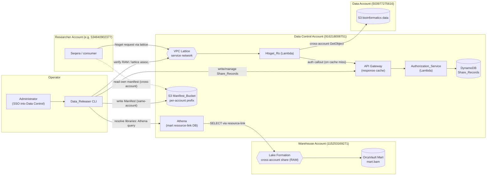

# Data Releaser

Data Releaser is a Go CLI tool that lets UMCCR administrators grant external
researchers time-bounded (or unlimited) access to specific bioinformatics
libraries, served through [htsget-rs](https://github.com/umccr/htsget-rs) over a
private VPC Lattice connection.

Given a set of `library_id`s and a target researcher AWS account, the tool:

1. verifies the researcher can reach htsget-rs (VPC Lattice / RAM association);
2. resolves each library to concrete S3 locations by querying the OrcaVault data
   warehouse (its curated `mart` layer) via Athena over a Lake Formation share;
3. records the grant as a `Share_Record` in an authorization backend it owns in
   the Data Control account; and
4. publishes a per-researcher manifest describing what the researcher can query.

htsget-rs then calls that authorization backend at request time to decide, per
researcher, which S3 prefixes may be served — so access is dynamic and reflects
the current state of shares.

> **Scope note.** The current version shares aligned-read BAM files only
> (`.bam` plus the co-located `.bai` index). Variant (VCF/BCF) sharing is
> deferred until a corresponding warehouse mart exists.

## What this repository contains

This repository holds three deliverables in one place:

| Path | Deliverable |
| --- | --- |
| `main.go`, `cmd/`, `internal/` | The `data-releaser` Go CLI and its logic |
| `functions/authorization`, `functions/admin` | Go AWS Lambda entrypoints for the Authorization Service (callout + admin) |
| `infrastructure/` | AWS CDK (TypeScript) app that deploys the Data Control account resources this project owns |

`htsget-cache/` and `htsget-rs/` are related to the upstream htsget-rs callout
caching contribution (see [`docs/manifest.md`](docs/manifest.md) and the design
document); they are not part of the CLI build.

## Account topology

The workflow spans several AWS accounts. Boundaries are accounts; edges are the
trust and data flows between components.

| Account | ID | Role |
| --- | --- | --- |
| Data Control | `916218008751` | Hosts htsget-rs, the Authorization Service, the Share_Record table, VPC Lattice, and the Manifest_Bucket. Owner of **all** Share_Records. The account the CLI authenticates into. |
| Data | `503977275616` | Holds the actual bioinformatics S3 files that htsget-rs serves. |
| Warehouse | `115253169271` | Hosts OrcaVault/OrcaHouse and shares the `mart` layer to Data Control via Lake Formation. |
| Production | `472057503814` | Hosts the upstream OrcaBus services. Not accessed by the tool for resolution. |
| Researcher | e.g. `534840902377` | External account that consumes shared data via VPC Lattice. |



## How the pieces relate

- **The CLI (`data-releaser`)** runs under a single authenticated session into
  the Data Control account (resolved via the standard AWS credential chain). It
  is the administrator's control surface: `share`, `revoke`, `extend`, `list`,
  and `validate`. It deploys nothing and creates no IAM at runtime.
- **The Authorization Service** is a pair of Go Lambdas behind an API Gateway
  REST API in the Data Control account, backed by a DynamoDB `ShareRecords`
  table. Its *admin* interface is used by the CLI to create/revoke/extend/list
  shares; its *callout* interface is used by htsget-rs to decide access.
- **Htsget_Rs** is the GA4GH htsget server (deployed elsewhere) in the Data
  Control account. On each request it calls the Authorization Service (subject
  to caching) to learn which S3 prefixes the requesting researcher may access,
  then streams the bytes from the Data account via a cross-account IAM role.
- **The OrcaVault Mart** (`mart.bam`) is the single source that maps
  `library_id -> portal_run_id -> S3 path`. The CLI reads it read-only via
  Athena over a Lake Formation share; it never touches the Warehouse account
  directly. Because the Mart is a daily-batch warehouse, resolution reflects the
  most recent build and may lag live OrcaBus state by up to roughly a day.

For the authorization data flow, caching semantics, and correctness properties,
see the design document at `.kiro/specs/data-releaser/design.md`.

## Quick start

```sh
# Build the CLI
go build -o data-releaser .

# Provide a config file (see docs/configuration.md for every field)
cp config.example.yaml config.yaml   # then edit

# Confirm the infrastructure is healthy before sharing
./data-releaser validate

# Share two libraries with a researcher account for 30 days
./data-releaser share --libraries L2400001,L2400002 --account 534840902377 --expiry 30d
```

> Building the whole module with `go build ./...` currently fails because
> `infrastructure/node_modules/` contains stray files the Go toolchain tries to
> parse. Build the Go code with an explicit package scope instead:
> `go build ./cmd/... ./internal/... ./functions/... .`

## Documentation

| Document | Answers |
| --- | --- |
| [`docs/usage.md`](docs/usage.md) | How to run each command, with flags, worked examples, and the exit-code convention |
| [`docs/configuration.md`](docs/configuration.md) | Every config field, defaults, flag precedence, config search paths, annotated example |
| [`docs/deployment.md`](docs/deployment.md) | How to deploy the Infrastructure_Stack, and how its outputs map to config |
| [`docs/prerequisites.md`](docs/prerequisites.md) | The per-account prerequisite checklist — what each account must have, who owns it, and how to verify it (largely via `validate`) |
| [`docs/onboarding.md`](docs/onboarding.md) | The end-to-end procedure for onboarding a Researcher_Account across the data plane (RAM/VPC Lattice) and manifest plane, ending in a `validate` check |
| [`docs/operations.md`](docs/operations.md) | Operational characteristics an administrator must understand: Cache_TTL-bounded revocation, what `--flush-cache` does, immutable library sets, idempotent creation, and ~1-day warehouse lag |
| [`docs/manifest.md`](docs/manifest.md) | The manifest's JSON schema and location, and why it is descriptive only and never consulted for authorization |
| [`RUNBOOK.md`](DEMO.md) | Step-by-step verification of the whole system against live AWS, from `cdk deploy` through a real htsget read, including the negative tests that prove authorization works |

All four of the operator documents above now live under `docs/`.
