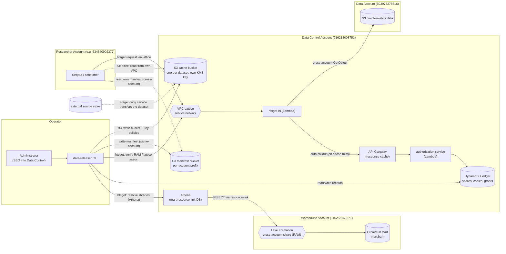

# Data Releaser

Data Releaser is a Go CLI tool that lets UMCCR administrators grant external
researchers time-bounded (or unlimited) access to bioinformatics data held by
UMCCR, through one of **two release mechanisms that share these verbs and nothing
else**.

- **`htsget`** — the researcher streams range requests for named libraries
  through [htsget-rs](https://github.com/umccr/htsget-rs) over a private VPC
  Lattice connection, and an authorization callout consults the share record on
  every request. The record *is* the enforcement point, so it cannot drift from
  what is enforced.
- **`s3`** — a whole dataset is copied into a bucket in this account and a
  researcher account is granted direct read access to it from one nominated VPC.
  Access is enforced by that bucket's policy and by the policy of the key
  encrypting it, evaluated by AWS on every request, with nothing of ours in the
  read path.

The mechanism is named as part of every invocation and is **never** inferred
from which flags were given: the two grant quite different access, and the
mistake surfaces only much later as an unexplained deny or an unintended grant.
A verb that changes access refuses to act without one; the read-only verbs
`list` and `validate` cover both when none is named.

Sharing through **htsget**, given a set of `library_id`s and a target researcher
AWS account, the tool:

1. verifies the researcher can reach htsget-rs (VPC Lattice / RAM association);
2. resolves each library to concrete S3 locations by querying the OrcaVault data
   warehouse (its curated `mart` layer) via Athena over a Lake Formation share;
3. records the grant as a share record in an authorization backend it owns in
   the Data Control account; and
4. publishes a per-researcher manifest describing what the researcher can query.

htsget-rs then calls that authorization backend at request time to decide, per
researcher, which S3 prefixes may be served — so access is dynamic and reflects
the current state of shares.

Sharing through **s3**, the dataset is first `stage`d — copied out of the
external source store into a cache bucket that holds only that dataset — and
then `share`d to one researcher account and one VPC. The ledger keeps those two
things as separate records, because they are separate things with separate
lives:

- a **copy** is one transfer of one dataset into this account, owning the
  provenance of the bytes and nothing about who may read them;
- a **grant** is one researcher's access to one copy: their account, the VPC
  their reads must arrive from, and when the access ends.

Several grants stand against one copy and the copy outlives all of them, so a
dataset released to two researchers is transferred once, and a researcher whose
access is withdrawn and later given back costs a policy write rather than
another copy. `purge` destroys a copy by scheduling deletion of the key it is
encrypted under, `restore` takes that back while the recovery window is still
running, and `delete` reclaims the storage the unreadable objects occupy.

> **Scope note.** The htsget mechanism shares aligned-read BAM files only
> (`.bam` plus the co-located `.bai` index). Variant (VCF/BCF) sharing is
> deferred until a corresponding warehouse mart exists.

## What this repository contains

This repository holds three deliverables in one place:

| Path | Deliverable |
| --- | --- |
| `main.go`, `cmd/`, `internal/` | The `data-releaser` Go CLI and its logic |
| `functions/authorization`, `functions/admin` | Go AWS Lambda entrypoints for the authorization service (callout + admin) |
| `functions/copycompletion` | Go AWS Lambda that records a finished dataset copy, moving it from `copying` to `staged` or `failed` |
| `infrastructure/` | AWS CDK (TypeScript) app that deploys the Data Control account resources this project owns |

## Account topology

The workflow spans several AWS accounts. Boundaries are accounts; edges are the
trust and data flows between components.

| Account | ID | Role |
| --- | --- | --- |
| Data Control | `916218008751` | Hosts htsget-rs, the authorization service, the ledger table, VPC Lattice, the manifest bucket, and each dataset's cache bucket and key. Owner of **every** record either mechanism writes. The account the CLI authenticates into. |
| Data | `503977275616` | Holds the actual bioinformatics S3 files that htsget-rs serves. |
| Warehouse | `115253169271` | Hosts OrcaVault/OrcaHouse and shares the `mart` layer to Data Control via Lake Formation. |
| Production | `472057503814` | Hosts the upstream OrcaBus services. Not accessed by the tool for resolution. |
| Researcher | e.g. `534840902377` | External account that consumes shared data — through htsget-rs over VPC Lattice, or by reading a copied dataset directly out of its cache bucket from one nominated VPC. |
| Source store | — | The external S3-compatible store the s3 mechanism copies datasets out of. Reached through a custom endpoint with credentials the copy orchestration resolves for itself; they never pass through the CLI. |



## How the pieces relate

- **The CLI (`data-releaser`)** runs under a single authenticated session into
  the Data Control account (resolved via the standard AWS credential chain). A
  researcher's account is named in a grant, never signed into. It is the
  administrator's control surface: `stage`, `share`, `extend`, `revoke`,
  `purge`, `restore`, `delete`, `list` and `validate`. It deploys nothing and
  creates no IAM identity or managed policy — the access the s3 mechanism grants
  is written into a bucket policy and a key policy, which the CLI does write.
- **The authorization service** is a pair of Go Lambdas behind a private API
  Gateway REST API in the Data Control account, backed by the DynamoDB ledger
  table. Its *callout* interface is what htsget-rs consults to decide access;
  its *admin* interface exists for external callers, and the CLI does not use
  it — `share`, `list`, `revoke` and `extend` read and write the table directly.
- **The copy orchestration** is deployed separately and is what actually moves a
  dataset for the s3 mechanism. `stage s3` starts a run and returns; the run
  takes hours to days, and its outcome arrives as an event that a Lambda in this
  repository (`functions/copycompletion`) records against the copy.
- **htsget-rs** is the GA4GH htsget server (deployed elsewhere) in the Data
  Control account. On each request it calls the authorization service (subject
  to caching) to learn which S3 prefixes the requesting researcher may access,
  then streams the bytes from the Data account via a cross-account IAM role.
- **The OrcaVault Mart** (`mart.bam`) is the single source that maps
  `library_id -> portal_run_id -> S3 path`. The CLI reads it read-only via
  Athena over a Lake Formation share; it never touches the Warehouse account
  directly. Because the Mart is a daily-batch warehouse, resolution reflects the
  most recent build and may lag live OrcaBus state by up to roughly a day.

For the authorization data flow, caching semantics, and correctness properties,
see the design document at `.kiro/specs/data-releaser/design.md`.

## Quick start

```sh
# Build the CLI
go build -o data-releaser .

# Provide a config file (see docs/configuration.md for every field).
# It is searched for at ./config.yaml, then ~/.config/data-releaser/config.yaml.

# Confirm the infrastructure is healthy before sharing. Bare, this checks both
# mechanisms; name one to narrow it to that mechanism's checks.
./data-releaser validate

# htsget: share two libraries with a researcher account for 30 days
./data-releaser share htsget --libraries L2400001,L2400002 \
  --account 534840902377 --expiry 30d

# s3: copy a dataset in, then grant one researcher read access from one VPC.
# Staging returns as soon as the copy has been started; nothing can be granted
# until it reports and the copy moves to staged.
./data-releaser stage s3 --dataset-uri s3://source-bucket/datasets/cohort-a/
./data-releaser share s3 --dataset-uri s3://source-bucket/datasets/cohort-a/ \
  --account 534840902377 --target-vpc-id vpc-0123456789abcdef0 --expiry 30d

# See both mechanisms' records, whatever state they are in
./data-releaser list
```

The mechanism is part of every invocation. `./data-releaser share --libraries …`
exits non-zero and names the forms that exist rather than guessing.

> `go build ./...` builds the whole module. The CDK app's
> `infrastructure/node_modules/` carries `.go` files that are not part of it, and
> `go.mod` excludes them with an `ignore` directive.

## Documentation

| Document | Answers |
| --- | --- |
| [`docs/usage.md`](docs/usage.md) | How to run each command, with flags, worked examples, and the exit-code convention |
| [`docs/configuration.md`](docs/configuration.md) | Every config field, defaults, flag precedence, config search paths, annotated example |
| [`docs/deployment.md`](docs/deployment.md) | How to deploy the CDK stacks, and how their outputs map to config |
| [`docs/prerequisites.md`](docs/prerequisites.md) | The per-account prerequisite checklist — what each account must have, who owns it, and how to verify it (largely via `validate`) |
| [`docs/onboarding.md`](docs/onboarding.md) | The end-to-end procedure for onboarding a researcher account across the data plane (RAM/VPC Lattice) and manifest plane, ending in a `validate` check |
| [`docs/operations.md`](docs/operations.md) | Operational characteristics an administrator must understand: cache-bounded htsget revocation, immutable library sets, idempotent creation, ~1-day warehouse lag, and the drift the s3 mechanism can develop |
| [`docs/manifest.md`](docs/manifest.md) | The researcher manifests' JSON schemas and locations, and why they are descriptive only and never consulted for authorization |
| [`DEMO.md`](DEMO.md) | Step-by-step verification of the whole system against live AWS, from `cdk deploy` through a real htsget read, including the negative tests that prove authorization works |
